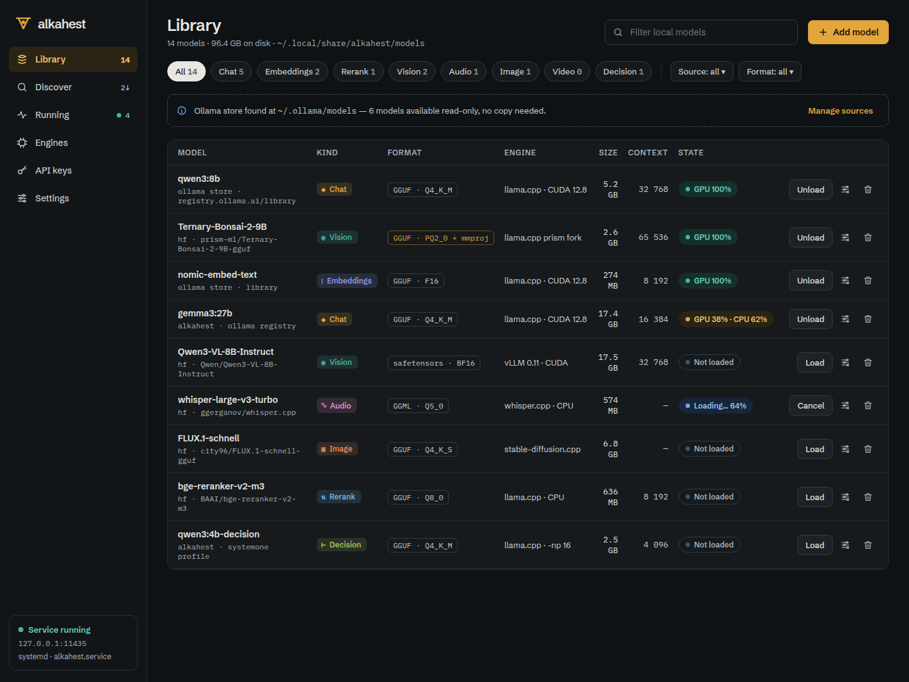
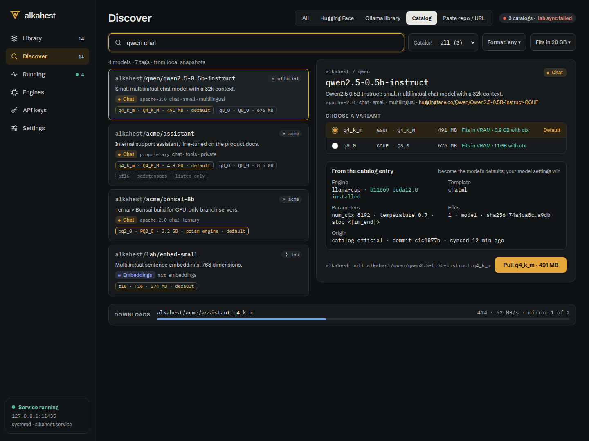
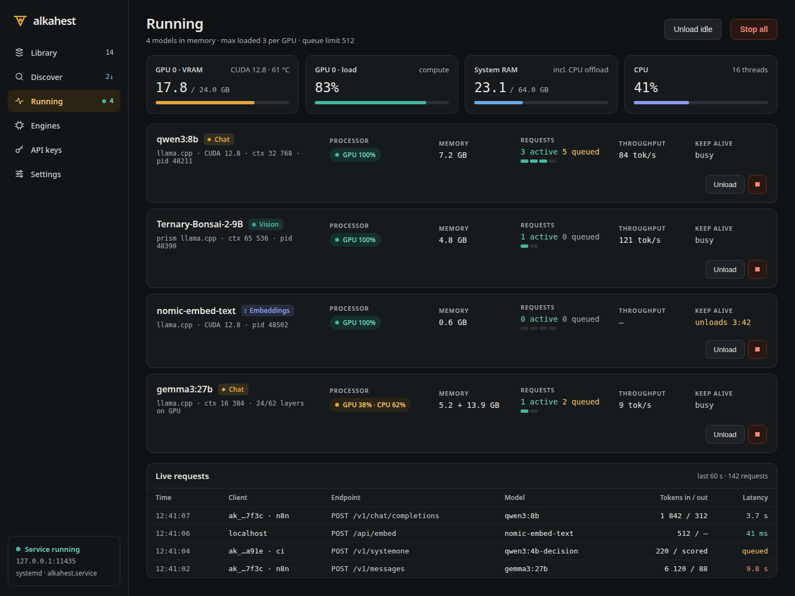

<p align="center">
  
</p>

<h1 align="center">Alkahest</h1>

<p align="center">
  Run AI models on your own machine: one compact binary, an Ollama-style CLI,
  every common API and a desktop app.
</p>

<p align="center">
  <a href="https://github.com/digiogithub/alchemai-alkahest/releases/latest"></a>
  <a href="https://github.com/digiogithub/alchemai-alkahest/actions/workflows/ci.yml"></a>
  <a href="https://github.com/digiogithub/alchemai-alkahest/actions/workflows/release.yml"></a>
  <a href="LICENSE"></a>
</p>

<p align="center">
  
</p>

## What it does

- **Downloads models from anywhere**: the Ollama registry, Hugging Face (GGUF and safetensors),
  git catalogs of curated models, or a GGUF file or folder you already have.
- **Reuses your Ollama models** without copying them: an existing Ollama store is read, never
  written.
- **Loads models on demand** and unloads them after a keep-alive, so idle models cost nothing.
  Several models can be loaded at once, on GPU, CPU or split between them.
- **Picks the right engine** for each model and machine: llama.cpp (CUDA, Vulkan, ROCm, Metal or
  CPU), the PrismML fork for ternary Bonsai models, vLLM for safetensors, whisper.cpp for speech
  and stable-diffusion.cpp for images. Engines are downloaded prebuilt or compiled for your CPU.
- **Speaks every common API** on one port: Ollama, OpenAI (chat, completions, embeddings,
  responses, audio, images), Anthropic Messages and a decision API for classification and
  routing. Existing clients work by changing the base URL.
- **Is safe to expose**: loopback needs no key; other machines need API keys (scoped, expiring,
  per model), with optional TLS, usage and audit logs.
- **Has a desktop app** (`alkahest desktop`) to browse, download, configure and watch models.

## Install

Download the package for your system from the
[latest release](https://github.com/digiogithub/alchemai-alkahest/releases/latest):

| System | Package |
|---|---|
| Linux | `.deb`, `.rpm`, `.AppImage` (desktop) or `alkahest-<version>-<target>.tar.gz` (server and CLI only) |
| macOS | `Alkahest_<version>_aarch64.dmg` (Apple Silicon) or `_x64.dmg` (Intel) |
| Windows | `alkahest_<version>_x64-setup.exe` or the `.zip` |

Every package ships a CPU build of llama.cpp, so it works out of the box. For your GPU:

```sh
alkahest engines install llama-cpp            # best build for this machine (CUDA, Vulkan, ROCm, Metal)
alkahest engines install llama-cpp --native   # or compile one tuned to this CPU
```

Setup scripts (`scripts/setup/install.sh`, `install.ps1`), Homebrew, Docker and running as a
service are covered in the [install guide](docs/book/src/install.md). Already installed?
`alkahest update` moves to the newest release.

## Quick start

```sh
alkahest pull llama3.2:3b                         # from the Ollama registry
alkahest pull hf.co/ggml-org/tiny-llamas:Q4_0     # from Hugging Face
alkahest serve                                    # listens on 127.0.0.1:11435
alkahest run llama3.2:3b "Why is the sky blue?"   # in another terminal
```

`alkahest ls` lists what you have, `alkahest ps` what is loaded, `alkahest stop` unloads.
Port 11435 is one above Ollama's, so both can run side by side.

## Use it from your applications

Point any Ollama, OpenAI or Anthropic client at `http://127.0.0.1:11435`:

```python
from openai import OpenAI

client = OpenAI(base_url="http://127.0.0.1:11435/v1", api_key="unused-on-loopback")
reply = client.chat.completions.create(
    model="llama3.2:3b",
    messages=[{"role": "user", "content": "Hello"}],
)
print(reply.choices[0].message.content)
```

```sh
curl http://127.0.0.1:11435/api/chat -d '{"model":"llama3.2:3b","messages":[{"role":"user","content":"Hello"}]}'
```

The [API reference](docs/book/src/reference/api.md) lists every route, including the Anthropic
Messages API, embeddings, reranking, speech, images and decisions.

## Models from a catalog or from disk

Alkahest reads curated catalogs of models and engine builds from git repositories, so new
entries arrive without a new release. The official catalog lives in [`catalog/`](catalog/);
you can add your own, private ones included.

```sh
alkahest search qwen --source catalog
alkahest pull alkahest/qwen/qwen2.5-0.5b-instruct
alkahest catalog add mycompany https://github.com/mycompany/models --subdir catalog
```

Models you already have on disk are added the same way, from a GGUF file, a folder (split
shards, a vision projector, a `Modelfile`, or a Hugging Face safetensors folder) or an
Ollama-style `Modelfile`. The source files are never modified:

```sh
alkahest import ~/models/mistral-7b-instruct.Q4_K_M.gguf     # copy into the store
alkahest import ~/models/qwen2-vl/ --name qwen2-vl --link    # register in place, no copy
alkahest create my-assistant -f Modelfile                     # FROM ./file.gguf, TEMPLATE, PARAMETER ...
alkahest run ./tiny.gguf "Hello"                              # import and run in one step
```

## Serve other machines

```sh
alkahest keys create laptop --expires 30d     # prints the key once
alkahest serve --host 0.0.0.0:11435           # non-loopback requests now need a key
```

Keys can be limited to inference or admin and to specific models. TLS, reverse proxies, CORS,
limits and monitoring are described in [Serving and security](docs/book/src/guide/serving.md).

## Desktop app

<p align="center">
  
  
</p>

`alkahest desktop` opens the library, model discovery, per-model settings, running models,
engines, API keys, catalogs and settings, with a tray icon. It talks to the server over the same
API as any client. See the [desktop guide](docs/book/src/guide/desktop.md).

## Documentation

The user guide is in [`docs/book/src`](docs/book/src/SUMMARY.md) (build it with
`mdbook build docs/book`):

- [Install](docs/book/src/install.md) and [Quick start](docs/book/src/quick-start.md)
- [Models](docs/book/src/guide/models.md), [Engines and recipes](docs/book/src/guide/engines.md),
  [Writing a catalog](docs/book/src/guide/catalogs.md)
- [Serving and security](docs/book/src/guide/serving.md),
  [Configuration](docs/book/src/guide/configuration.md),
  [Running as a service](docs/book/src/guide/service.md), [Docker](docs/book/src/guide/docker.md)
- Reference: [command line](docs/book/src/reference/cli.md),
  [API](docs/book/src/reference/api.md),
  [configuration keys](docs/book/src/reference/configuration.md)
- [Troubleshooting](docs/book/src/troubleshooting.md) and [FAQ](docs/book/src/faq.md)

## Build from source

```sh
cargo build --release -p alkahest --no-default-features   # server and CLI
cargo build --release -p alkahest --features desktop      # with the desktop app
```

The toolchain is pinned in `rust-toolchain.toml`. Contributor rules are in
[`AGENTS.md`](AGENTS.md).

## Licence

MIT, copyright 2026 Digio. See [`LICENSE`](LICENSE) and [`NOTICE`](NOTICE); third-party
licences are listed in the [licences page](docs/book/src/licences.md).
