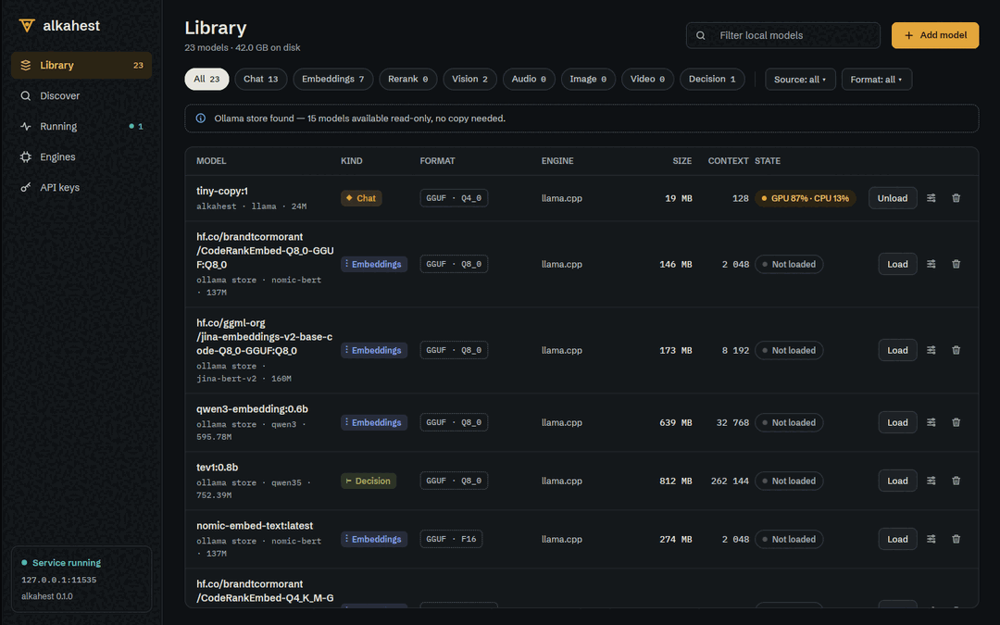
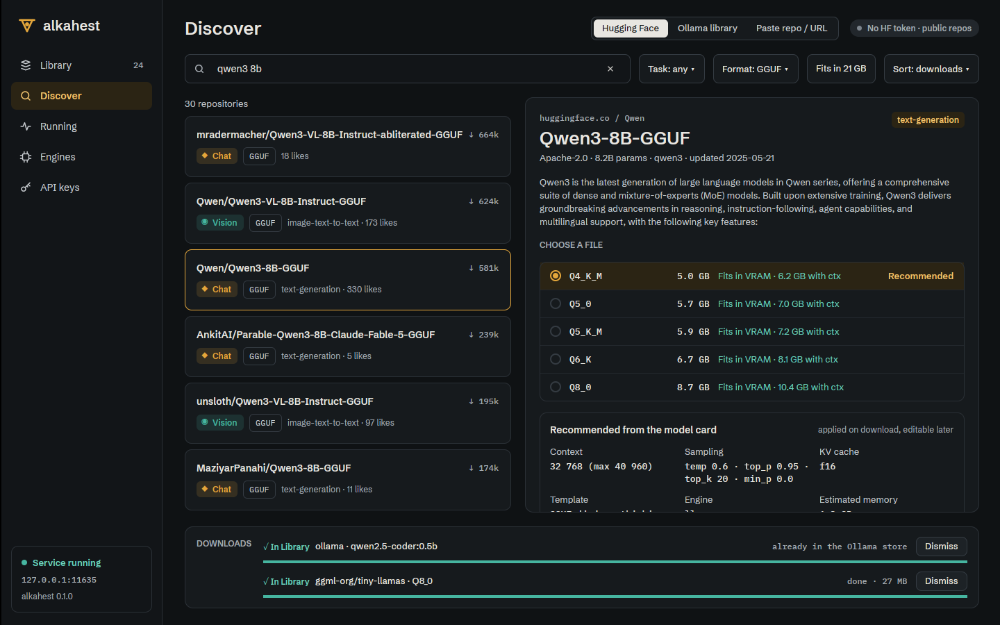
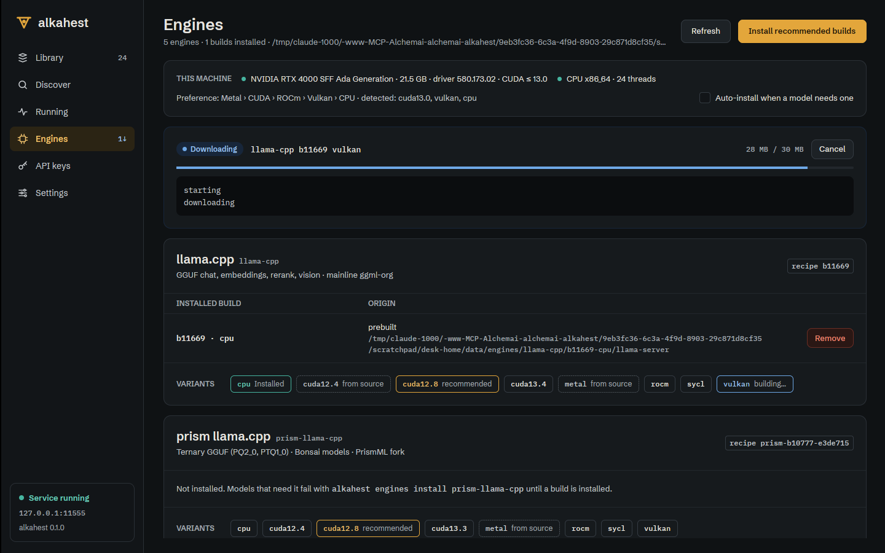

# Desktop app

`alkahest desktop` opens the desktop app. It needs a build with the desktop feature (the `.deb`
and AppImage have it; the headless archive does not).

The app is a client: it talks to a running Alkahest server over HTTP, the same API as the CLI,
so it can manage a remote server too. If no server answers on a local (loopback) address it
offers a **Start server** button, which uses the systemd user unit when installed and otherwise
starts a detached `alkahest serve`.

If the server is on another machine, or requires a key, set the address and the API key in
Settings. The key is kept in the OS keyring, or read from `ALKAHEST_API_KEY`.

When the connection drops the app says so and retries; nothing is lost.

## Library

Your models, from Alkahest's store and from a reused Ollama store: kind, format, quantisation,
size and last use. Open a model for its details and its settings; delete models you no longer
need (models of the read-only Ollama store cannot be deleted and say why).

## Discover

Browse the Ollama library and Hugging Face, see quantisations with their size and whether they
fit your memory, and download with progress, cancel and resume (a resumed download continues where it stopped). Gated repositories ask for a
Hugging Face token.

## Model settings

Per-model context length, GPU layers, KV cache types, flash attention, sampling defaults,
keep-alive and engine, with the memory estimate updating as you change them. Each value shows the
layer it comes from (your setting, the model card's recommendation, or the global default).

## Running

What is loaded now: memory per model, processor, queue, expiry; unload one model or all of them.

## Engines

Installed engine builds and what can be installed for your hardware, with install progress.

## API keys

Create, expose once and revoke keys, with usage counters. Brass marks the one primary action of
a view; red is used only for destructive actions.

## Settings

Server address and network exposure, storage locations, loading behaviour, logging, and launch
at login.

## Tray and autostart

The app keeps a tray icon (disable it with `ALKAHEST_DESKTOP_TRAY=0` on desktops without a tray
host). "Start Alkahest at login" installs an XDG autostart entry on Linux (a LaunchAgent on macOS, a
`Run` value on Windows) that runs `alkahest desktop --start-server`: the app opens and, when no
server answers, starts the local one, through the systemd user unit when `alkahest service
install --user` installed it. When a system service (systemd system unit, launchd job, Windows
service) is installed, the app leaves the server to it. An entry from an older version is updated
the next time the app starts.

## Smoke test

`alkahest desktop --smoke-test` renders one frame and exits; use it to check that the graphics
stack works on a new machine (under `xvfb-run` on a headless one).
