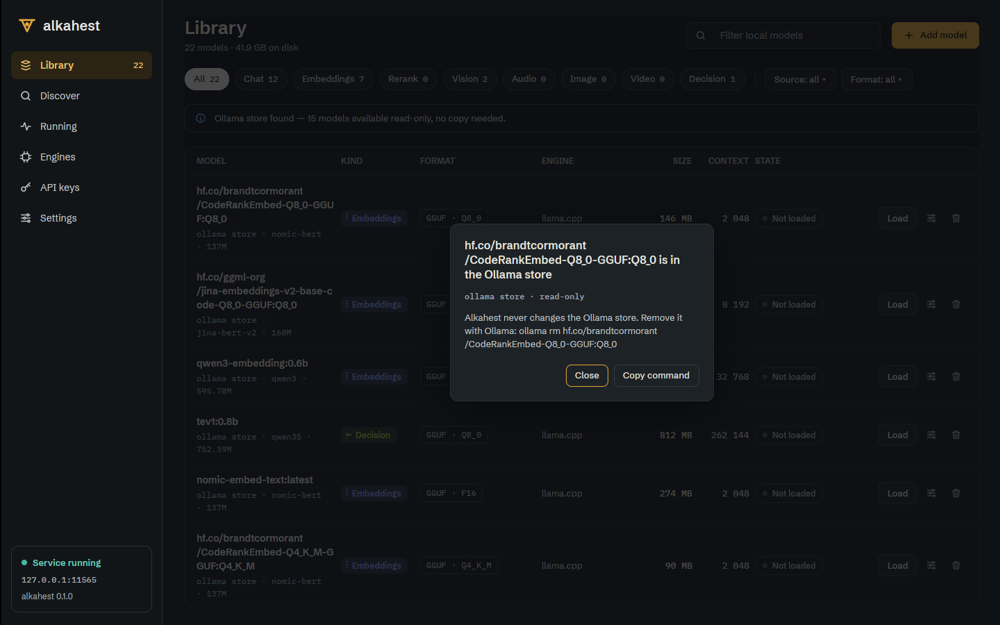
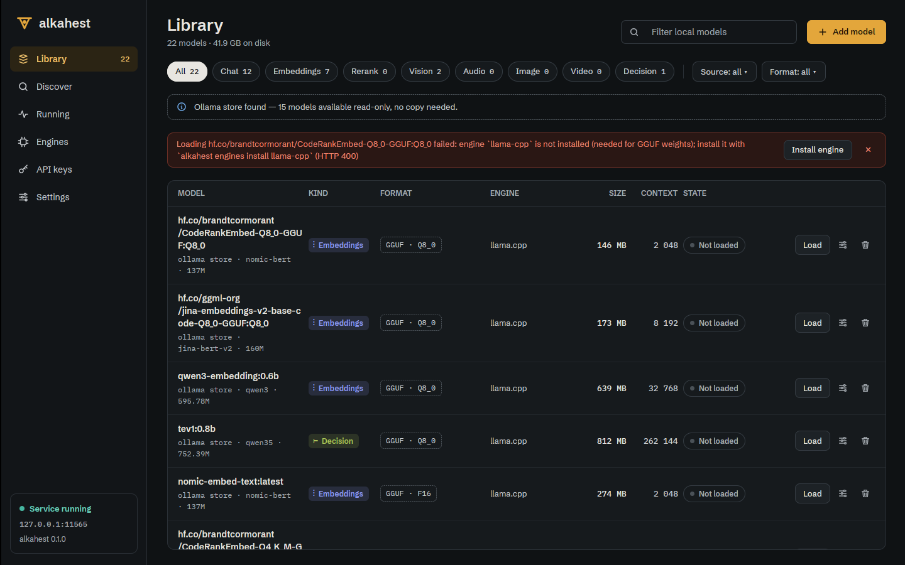
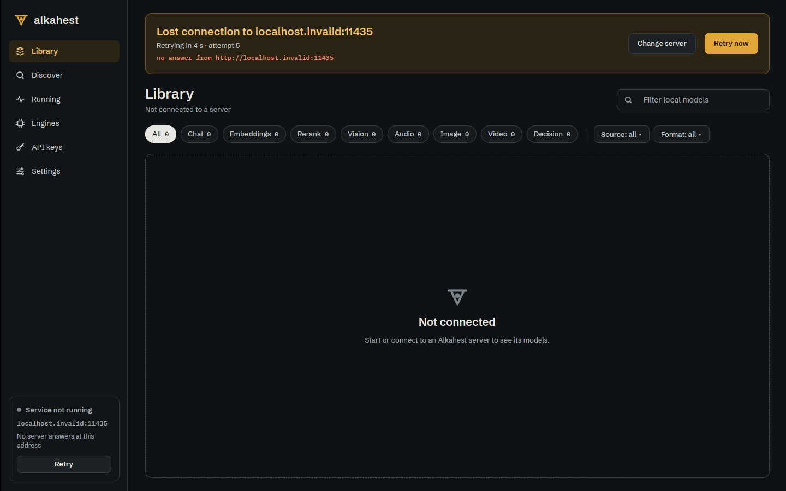

# Desktop dialogs, retry countdown and failure actions (ALK-US-0108)

Story [[ALK-US-0108]]. Builds on [[2026-10-17-desktop-missing-screens-design]] (screen 17),
[[2026-10-17-desktop-server-connection]] and [[2026-10-17-desktop-https-private-ca]].
Plan: [[plan/alkahest-v1-plan]].

## What changed

- **Esc and backdrop cancel** (17.9-17.14). `views::widgets::dismissable(scrim, on_cancel, window,
  cx)` wraps a dialog scrim: it takes the keyboard focus when the dialog appears (GPUI keyed
  state, no field in the views), cancels on Esc, on Enter while the dialog itself has the focus
  (Cancel is the default button; inside a text field Enter stays the field's) and on a click on
  the backdrop. `dialog()` stops propagation of presses inside the card so only the backdrop
  cancels. Applied to delete model and "in the Ollama store" (Library), stop all (Running),
  remove build (Engines), revoke key (API keys) and the Hugging Face token dialog (Discover).
  `is_cancel_key` is the pure rule (unit tested). The facade (`ui/mod.rs`) re-exports
  `FocusHandle`, `KeyDownEvent`, `MouseButton`, `AnyView` and adds `text_tooltip`.
- **Retry countdown** (17.5). `connection::RetryInfo { due, delay, attempt, last_seen }`, kept by
  `Machine` (`retry()`), carried by `Snapshot::retry`. `describe(now)` gives `Retrying in 4 s .
  attempt 5 . last seen 14:03:11 UTC`; the shell re-renders once a second while a retry is
  pending and the banner shows the line (times are UTC like the rest of the app). Backoff and
  "Retry now" are unchanged.
- **17.8 failure actions**, with the existing client APIs:
  - Load failed for memory (`503 ... does not fit in memory`): notice buttons "Open settings",
    "Lower context" (opens model settings with the context field focused) and "Unload others &
    retry" (`ModelOp::UnloadAllThenLoad`: unload all, then load).
  - Engine missing (`engine `X` is not installed`): "Install engine" starts the install
    (`install_engine`, server picks the best variant) and opens the Engines screen.
    Classified by `ops::classify_load_failure` into `FailureCause`; `Notice` carries
    `NoticeAction`s.
  - Engine build failed (Engines job card): "Retry" (same engine/version/variant, a source
    build stays a source build, `force`), "Install prebuilt instead" (only after a build from
    source), "View log" shown disabled with a tooltip (no server API for build logs: inbox item
    [[ALK-US-0110]]).
  - Downloads strip (17.7) already had Retry / Resume / Discard and "Add HF token" for gated
    repos. For a checksum mismatch the server has already deleted the bytes, so the action is
    Retry (as in `design/README.md`); no "delete partial" API exists or is needed.

## Verification

- `WAYLAND_DISPLAY= scripts/ci-local.sh --desktop` (see commit message), 110 desktop tests; new:
  `connection::tests::the_retry_countdown_follows_the_backoff`,
  `ops::tests::{load_failures_are_classified_for_the_recovery_actions,
  unload_all_then_load_runs_in_that_order}`, `library::tests::failed_loads_offer_their_way_out`,
  `engines::tests::a_failed_source_build_offers_retry_and_prebuilt`,
  `widgets::tests::cancel_keys`.
- Under Xvfb against `alkahest serve` (scratch home, TLS on):
  - dialog "in the Ollama store": Esc closes, Enter closes, a click on the backdrop closes, a
    click inside the card does not;
    
  - Load on a model without an engine build (real failure, auto-install off): notice with
    "Install engine";
    
  - unreachable remote server: banner counts down with the attempt number;
    
- Not exercised in a real session: the memory failure (needs a model larger than free memory;
  covered by the classifier and state tests) and a failed source build (needs a toolchain
  failure; covered by `job_cards` tests).
