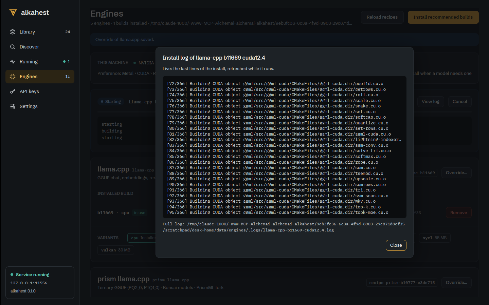
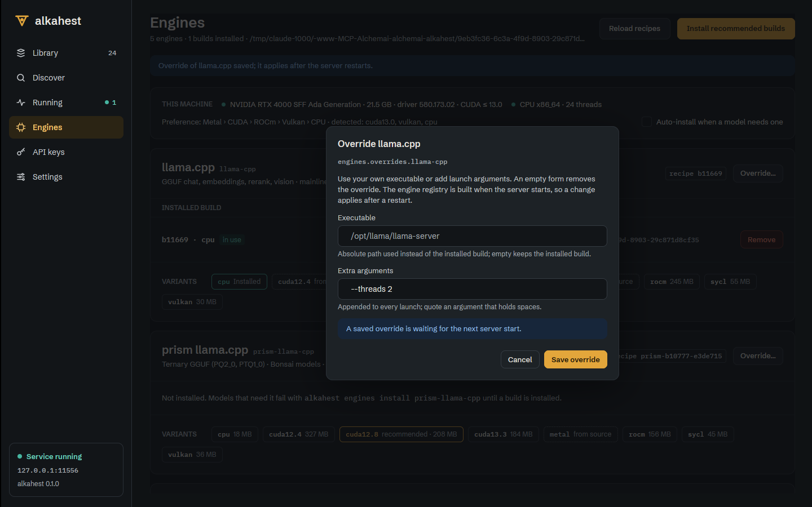
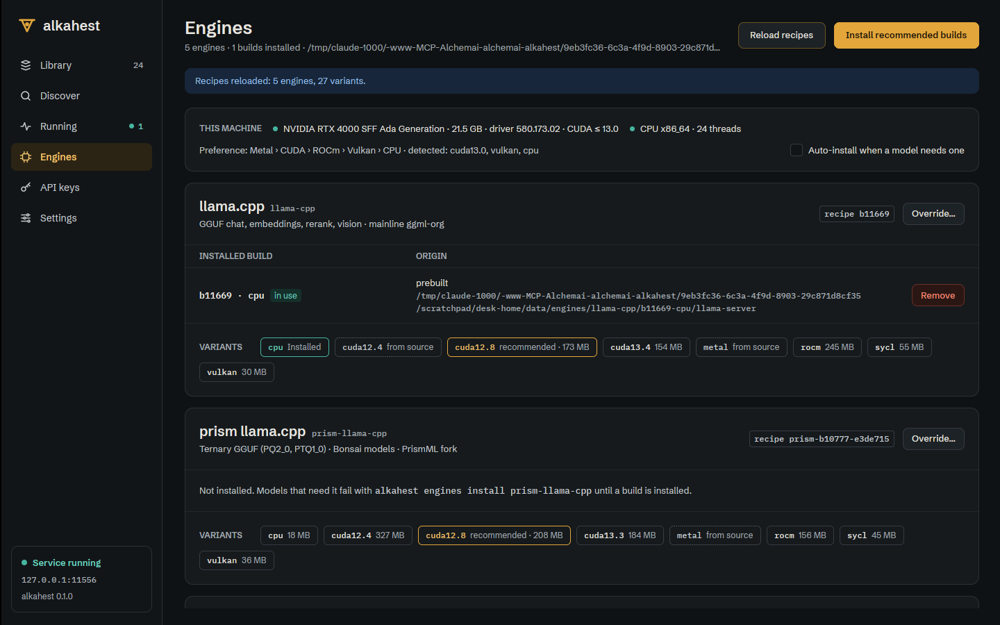

# Desktop Engines: install log, reload recipes, override sheet (ALK-US-0107)

Date: 2026-10-17. Desktop part of [[ALK-US-0107]] ([[ALK-SP-0003]].R3-R5, [[ALK-SP-0008]].R5). Server part:
[[2026-10-17-engines-admin-log-reload-overrides]]. Builds on [[2026-10-17-desktop-keys-engines-settings]]
and [[2026-10-17-desktop-dialogs-and-failure-actions]]. Plan: [[plan/alkahest-v1-plan]].

## What changed

- `alkahest-desktop/src/engines.rs` (GPUI-free): `InstalledBuild::bundled` and `VariantChip` notes with the
  download size (`recommended · 173 MB`, `30 MB`; unsupported chips keep their reason); `split_args` /
  `join_args` (quotes keep spaces in one argument), `OverrideForm` (`from_override`, `to_override` with an
  absolute-path check for Linux, macOS and Windows paths), `reload_summary` (counts, and the recipe files the
  server ignored with the reason, flagged as a warning).
- `alkahest-desktop/src/views/engines.rs`:
  - "Reload recipes" replaces "Refresh": `Client::reload_recipes`, then the listing reloads; the notice names
    ignored recipe files.
  - "View log" is enabled on every install job card: `LogSheet` shows the last 24 lines of
    `Client::job_log` (200 requested) in a wide dialog, polls every 1.5 s while the job runs (live tail) and
    names the full log file; Esc, the backdrop and Close dismiss it.
  - "Override..." on every engine card opens `OverrideSheet` (executable path and extra arguments, read with
    `Client::engine_override`, saved with `Client::set_engine_override`; an empty form removes the override;
    the notice says the change applies after a restart).
  - Bundled builds carry a `bundled` badge and have no Remove button.
- `alkahest-desktop/src/views/widgets.rs`: `dialog_sized` (the 380 px `dialog` is now a wrapper); the unused
  `with_tooltip` was removed together with the disabled "View log" it served.

## Why

[[ALK-SP-0003]].R3-R5 and design screen 15: build logs reachable from the card, recipe reload, per-engine
override, a bundled CPU build that cannot be removed and the download size next to each variant.

## Verification

- Unit: `engines::tests::{bundled_builds_and_download_sizes_show_in_the_cards,
  override_forms_round_trip_and_validate, reload_reports_ignored_recipes}`.
- Xvfb against `alkahest serve` (scratch home): the recommended chip showed `173 MB`; an install of
  `llama-cpp cuda12.4` from source ran with a live cmake tail (`[29/366]` then `[72/366]` between two shots)
  and was cancelled from the card; "Reload recipes" answered "5 engines, 27 variants"; the override sheet saved
  `--threads 2` (`restart_required: true` on the server, the sheet read it back on reopening) and an empty form
  removed it again.
- The bundled badge is covered by the unit test only (the scratch home has no bundled root).
