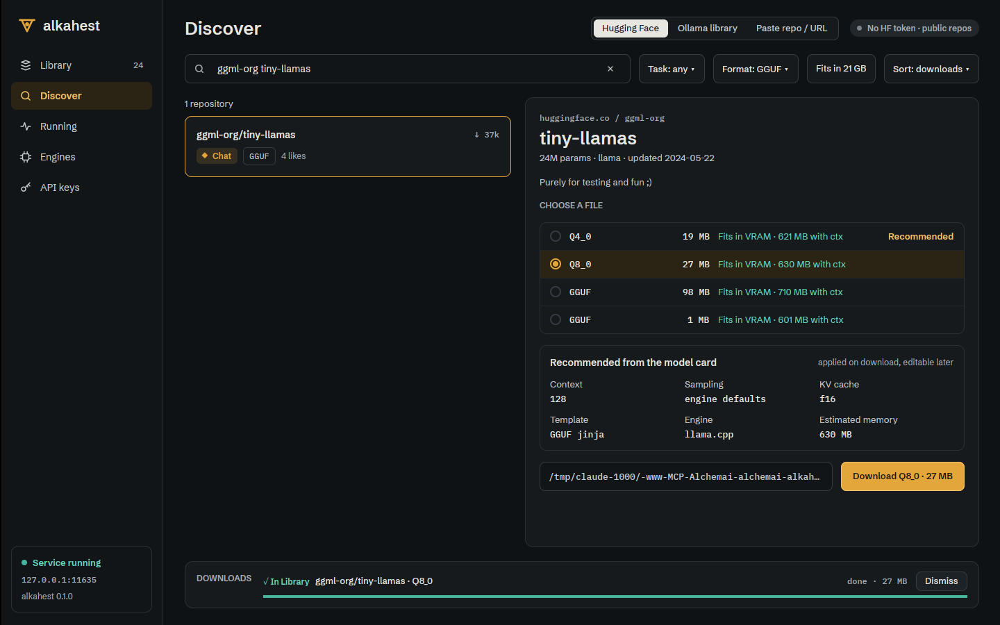
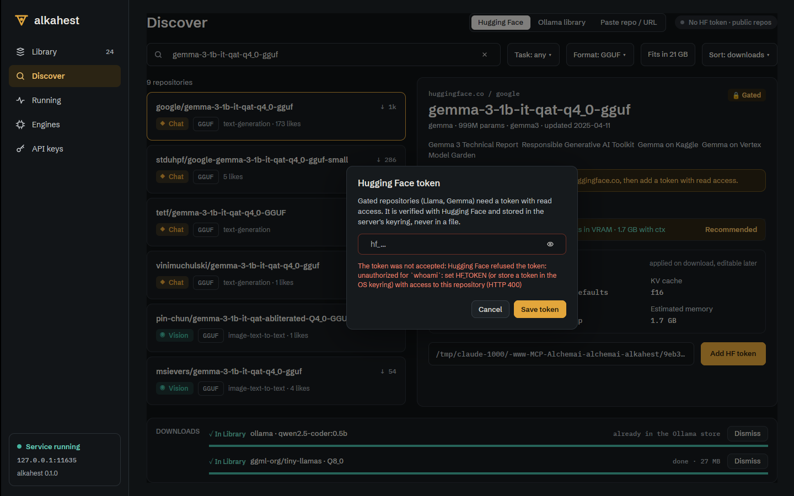

# Desktop Hugging Face browser and downloads (ALK-US-0067)

Date: 2026-10-17. Story [[ALK-US-0067]], requirement [[ALK-SP-0008.R4]], plan
[[plan/alkahest-v1-plan]]. Tasks ALK-T-0182, ALK-T-0183, ALK-T-0184. Builds on
[[2026-10-17-admin-api]] (HF proxies, token routes, pull jobs, `job` events),
[[2026-10-17-desktop-library-view]] and [[2026-10-17-desktop-server-connection]].

## What changed

- `alkahest-desktop`, GPUI-free (default workspace, unit tested):
  - `discover.rs`: `Source` (Hugging Face, Ollama library, Paste), `HfFilters` (query,
    `HfFormat` gguf / safetensors / any, `HfTask` pipeline tags, `HfSort` downloads / likes /
    recent, `fits_only`) -> `HfSearch`; `Fetch<T>`; `Hardware::from_system` (largest GPU's
    total/free VRAM, RAM, from `GET /alkahest/v1/info`) and `fits_label` ("Fits in 21 GB");
    `fit_for` -> `Fit` (`Gpu` / `Partial { gpu_percent }` / `Ram` / `TooLarge` / `Unknown`,
    file size x 1.12 + 600 MB against free memory); `hf_row` (kind from the pipeline tag,
    format tag, ternary detection), `repo_header` (breadcrumb, licence, params, arch, update
    date, gated), `card_summary` (first prose paragraph of the README, Markdown stripped),
    `quant_rows` (one row per GGUF quant plus the safetensors snapshot with
    `PullRequest.safetensors`, recommended = first fitting of Q4_K_M, Q4_K, Q5_K_M, ... else the
    smallest that runs), `recommended_block` (context with the trained maximum, sampling, KV
    cache, template / thinking, engine, estimated memory), `token_pill`, `check_token`,
    `parse_paste` -> `PasteTarget` (Hub URLs, `hf.co/org/repo[:quant]`, `org/repo`, Ollama
    tags and URLs; path-like input refused), `DiscoverState` (selection, quant choice, token
    dialog, request generations so a stale search or detail answer is dropped,
    `hf_selection_after_search`, `needs_token`).
  - `downloads.rs`: `DownloadsState` over pull jobs (`upsert` from `job` events,
    `replace_all` from `GET /pulls`, `remember` / `retry_request`, `discard`, `active`,
    `is_pulling`, `rows`): speed over a 5 s window, ETA, phases (resolving, downloading,
    verifying sha256, finishing), `FailureKind` (Interrupted with bytes kept -> Resume,
    Checksum -> Retry, Gated -> Add HF token, Other), "already in the Ollama store" for a
    reused model; `Transition::Completed` once per job.
  - `ops.rs`: the Library list now comes from `Client::models()` (one admin call) through
    `library_model(&CatalogModel)`; 401/403/404/405 fall back to the composed
    `Client::library()` (old server or key without the admin scope).
- GUI (`gui` feature): `views/discover.rs` `DiscoverView`: segmented source control, HF token
  pill (opens the token dialog), search field (debounced 450 ms, Enter runs at once), Task /
  Format / Sort menus, "Fits in N GB" toggle, results list (brass border on the selection),
  detail panel (header, card summary, gated banner, quant picker with radio, size, fit hint and
  "Recommended", vision projector line, "Recommended from the model card" block, destination
  folder, brass "Download Q4_K_M · 5.0 GB" or "Add HF token"), Paste tab, downloads strip
  (progress meter brass / signal blue / verdigris / cinnabar, detail, Cancel, Resume / Retry,
  Discard / Dismiss, "Add HF token" on a gated failure). A job feed (tokio task: `GET /pulls`,
  then `job` events of `/alkahest/v1/events`, reconnecting every 2 s) runs while connected.
  Token dialog: masked kit input with reveal toggle, focused on open, verified by the server
  (`PUT /hf/token` with `verify`), cleared at once; searches are suppressed while it is open.
  `Shell` owns the view, forwards snapshots, shows the active downloads in the rail counter and
  calls `LibraryView::reload` on `DiscoverEvent::ModelsChanged`. Widgets: `segment`,
  `segmented`, `card` (never shrinks in a scrolling column), `notice_line`, `field_frame`.

## Why

ALK-SP-0008.R4: search Hugging Face, show the model card, pick a quantisation and download to
the store with progress. All of it goes through the server's admin proxies, so the desktop
holds neither a Hub client nor the token, and a remote desktop works the same way.

## Verification

- Scenario test `downloads::tests::download` (ALK-SP-0008.R4 "download": progress shown,
  completion reported once so the Library refreshes). Plus `discover::tests::*` (hardware,
  fit hints, picker recommendation, safetensors, stale searches, gated, rows/header/card,
  paste parsing) and `ops::tests::catalog_entries_become_library_rows`; GUI test
  `views::discover::tests::detail_renders_quants_and_completed_jobs_refresh_the_library`.
- `WAYLAND_DISPLAY= scripts/ci-local.sh --desktop`: all checks passed (see the story comment
  for the counts); `cargo machete` clean.
- End to end under Xvfb against `alkahest serve` (scratch `ALKAHEST_HOME`, port 11635, the
  machine's Ollama store read-only, NVIDIA 20 GB free): search "qwen3 8b" (30 repositories),
  Qwen3-8B-GGUF detail with five quants, Q4_K_M recommended, card block "32 768 (max 40 960)",
  "temp 0.6 · top_p 0.95 · top_k 20 · min_p 0.0"; download of `ggml-org/tiny-llamas` Q8_0
  (27 MB): strip progress, rail counter `1↓`, completion "In Library", Library counter 23 -> 24.
  
  Gated `google/gemma-3-1b-it-qat-q4_0-gguf`: lock pill, banner, "Add HF token"; a fake token
  was refused by the Hub through the server, the field cleared, `GET /hf/token` still
  `present: false`.
  

## Deviations and follow-ups

- Fit hints use a size heuristic: the precise estimator needs a local GGUF header. Inbox
  [[ALK-US-0104]] (remote estimate route).
- No server-side pause: Cancel stops a pull, Resume starts it again and the downloader
  continues from the bytes on disk.
- The "Fits in N GB" filter hides quants that do not fit (search results carry no sizes).
- The destination is always the Alkahest models folder (no per-download folder in the pull
  API), shown read-only.
