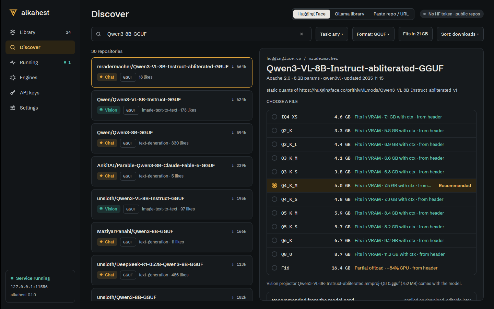

# Desktop Discover: precise fit from the remote estimate (ALK-US-0104)

Date: 2026-10-17. Desktop part of [[ALK-US-0104]] ([[ALK-SP-0004]].R3, [[ALK-SP-0008]].R4). Server part:
[[2026-10-17-hf-remote-estimate-kv-types]]. Builds on [[2026-10-17-desktop-hf-browser]].
Plan: [[plan/alkahest-v1-plan]].

## What changed

- `alkahest-desktop/src/discover.rs`: `fit_from_estimate` (server document to `Fit`: does not fit =
  too large; no VRAM = RAM; every layer and the output head on the GPU = GPU; otherwise a split with the
  GPU share of the estimated bytes), `EstimateState`, `EstimateTarget`, `DiscoverState::{estimates,
  estimates_wanted, finish_estimate}` (cache by repository and row label, each quant asked once, at most
  24 per repository, failures remembered so the size rule stays), `quant_rows_with` (precise fits replace
  the heuristic and `QuantRow::precise` is set; the recommended row is picked from the precise fits).
  Requests in flight are forgotten when the selection moves away.
- `alkahest-desktop/src/views/discover.rs`: `schedule_estimates` (600 ms after the files of a repository
  arrive, so clicking through the list reads no headers), `run_estimates` (`Client::hf_estimate` per
  visible quant, three at a time through a semaphore, results re-render the picker as they come),
  precise rows end with "from header".

## Why

The size rule (weights + 12 % + 600 MB) ignores context, KV cache type and architecture; the server
already reads the quant's real GGUF header remotely (ALK-US-0104) and answers with the scheduler's own
estimate.

## Verification

- Unit: `discover::tests::remote_estimates_replace_the_size_rule_once_they_arrive` (mapping, lazy once-only
  requests, precise rows and recommendation, failure keeps the heuristic, in-flight entries dropped on
  selection change).
- Xvfb against `alkahest serve` and the live Hub (`Qwen3-VL-8B-Instruct-abliterated-GGUF`): the rows
  switched one by one from the size rule to "from header" figures (for example Q4_K_M 6.2 GB with ctx
  became 7.5 GB; F16 became "Partial offload ~84 % GPU"); a repository whose GGUF has no `block_count`
  (not an LLM) kept the heuristic.
