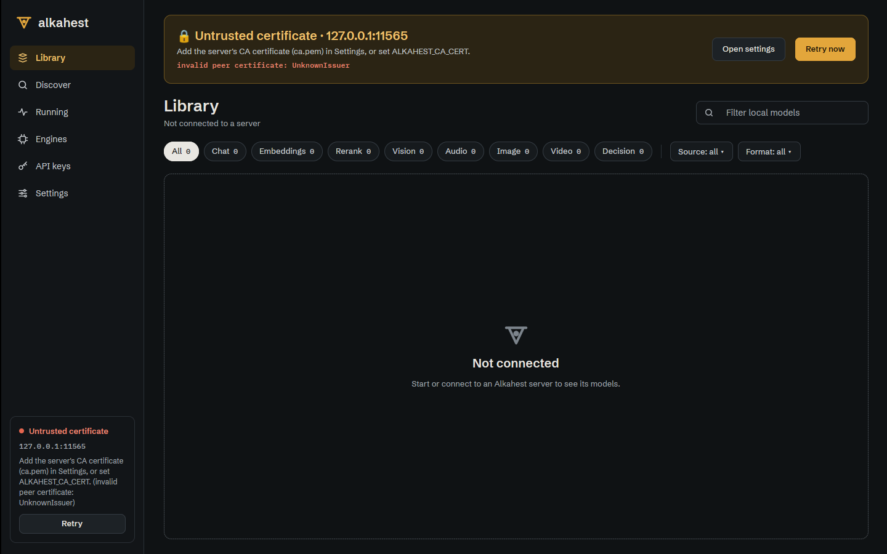
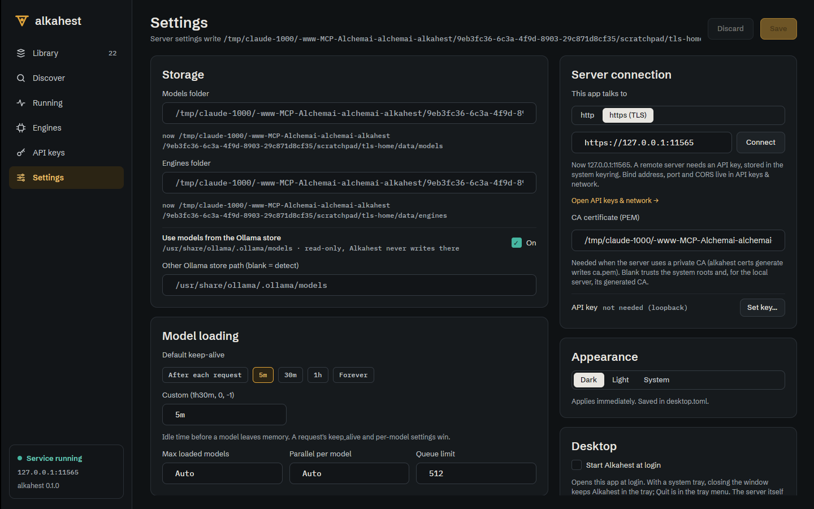
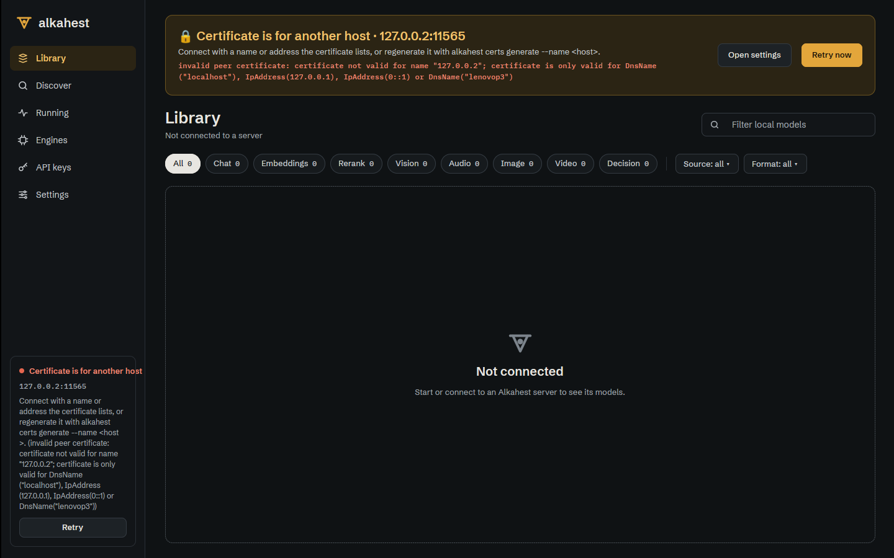

# Desktop app connects to an HTTPS server with a private CA (ALK-US-0106)

Story [[ALK-US-0106]] (security-tagged). Builds on [[2026-10-17-optional-tls]] and
[[2026-10-17-desktop-server-connection]]. Plan: [[plan/alkahest-v1-plan]].

## What changed

- `alkahest-desktop/src/tls.rs` (new, GPUI-free):
  - `resolve_ca_cert(url, env, saved, generated, is_default_server)`: only an `https` URL gets a
    CA. Order: `ALKAHEST_CA_CERT`, `ca_cert` of `desktop.toml`, then the generated
    `<data_dir>/tls/ca.pem`, which is used only for the configured local server and only when
    the file exists (a CA made for this machine says nothing about a third-party server).
  - `with_scheme`, `is_https` (scheme switch of a typed URL).
  - `TlsIssue` (`Untrusted`, `HostnameMismatch`, `Expired`, `Other`) with `title()`/`hint()`
    and `classify(message)` over the rustls error text.
- `LaunchOptions.generated_ca`; `alkahest desktop` now builds its URL with
  `Client::for_server(host, port, server.tls.enabled)` (https when `[server.tls] enabled`) and
  passes `server.tls.ca_path(data_dir)` when TLS is on. `app::connect` merges the resolved CA
  with `Client::with_ca_cert_file`; an unreadable CA is logged and the window still opens.
- `DesktopSettings.ca_cert` (`desktop.toml`).
- `connection`: `ProbeError::Tls` (from `ClientError::Tls`) and `ConnectionState::Tls { issue,
  detail }`; the service card shows the issue title and the fix, "Retry" is offered, "Start
  server" is not (a new process does not fix a certificate). Shell banner in the 17.5 frame with
  the lock, issue, hint, raw error, "Open settings" and "Retry now".
- Settings, server-connection card: `http` / `https (TLS)` switch (acts on the server in use when
  the field is blank), CA certificate field (shown for https; validated as an existing file on
  Connect; says when `ALKAHEST_CA_CERT` overrides it). `ConnectionDraft::{https, set_https, ca}`.

## Security checklist

| Threat | Mitigation | Proof |
|---|---|---|
| Client trusts any certificate | never `accept_invalid_certs`; the CA is merged with the system roots | `tls.rs`, `app::connect` (code review) |
| A CA generated for this machine trusts a remote server | generated CA only for the configured server (`is_default_server`) | `tls::tests::generated_ca_is_for_the_configured_server_only_and_must_exist` |
| Silent downgrade to http | scheme is explicit in the URL; the switch is a visible control | `settings_screen::tests::connection_url_and_key_status` |
| TLS failure reported as "not running" | `ClientError::Tls` -> `ConnectionState::Tls` with issue and fix | `connection::tests::tls_failures_get_their_own_state_and_card` |
| Secrets in `desktop.toml` | only a CA *path* is stored; the API key stays in the keyring | `settings::tests` |

## Verification

- `cargo nextest run -p alkahest-desktop --features gui`, clippy, fmt (see commit).
- Under Xvfb against `alkahest serve` with `[server.tls] enabled = true` and certificates from
  `alkahest certs generate` in a scratch `ALKAHEST_HOME`:
  - generated `ca.pem` present: the desktop connects with no configuration;
  - `ca.pem` removed: "Untrusted certificate" banner and card;
    
  - CA path typed in Settings, Connect: `desktop.toml` gets `server_url` and `ca_cert`, the app
    reconnects over TLS;
    
  - server on 127.0.0.2 (certificate lists 127.0.0.1): "Certificate is for another host".
    

## Open points

- Product owner review (security-tagged). The local launcher is unchanged: `alkahest serve`
  reads `server.tls` itself, so a launched server comes up with the configured scheme.
