# Desktop API keys, Engines, Settings and app states (screens 14-17)

Date: 2026-10-17. Stories [[ALK-US-0071]] (API keys and network, security-tagged),
[[ALK-US-0072]] (Engines), [[ALK-US-0081]] tasks ALK-T-0218 (Settings) and ALK-T-0219 (states
and confirmations), [[ALK-US-0095]] (server URL and API key form). Requirements
[[ALK-SP-0008.R7]], [[ALK-SP-0003.R4]], [[ALK-SP-0008.R2]]. Builds on
[[2026-10-17-desktop-missing-screens-design]], [[2026-10-17-admin-api]],
[[2026-10-17-desktop-server-connection]], [[2026-10-17-desktop-library-view]] and
[[2026-10-17-desktop-runtime-monitor]]. Plan: [[plan/alkahest-v1-plan]]. Earlier commit of the
branch: [[2026-10-17-model-detail-parameters-and-per-model-parallel]].

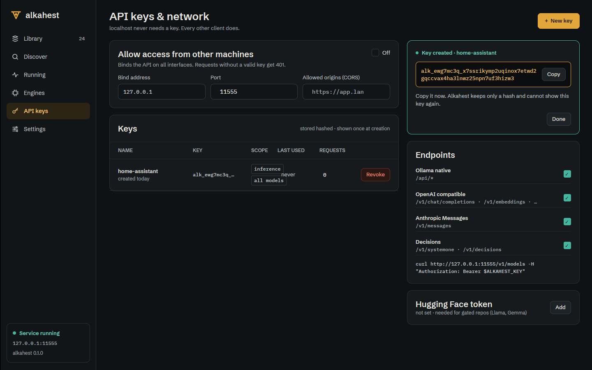

## What changed

### Server: `GET|PUT /alkahest/v1/settings/server` (commit `feat(api)`)

`alkahest-api` `admin/server_settings.rs`: `ServerSettings` (flat: `models_dir`,
`ollama_enabled`, `ollama_path`, `engines_dir`, `auto_install`, `keep_alive`, `max_loaded`,
`num_parallel`, `max_queue`, `log_level`, `log_format`, `log_file`, `log_dir`,
`log_rotation`, `log_max_files`), `FIELDS` (table path, key, overriding `ALKAHEST_*`
variable). GET: running, saved, `changed`, `restart_required`, `locked` (fields set by an
environment variable), `sources` (configuration layers, from `AdminContextBuilder::sources`,
passed by `alkahest serve`) and resolved folders. PUT: `{field: value}`, `null` resets; locked
fields refused (400 naming the variable); only patched keys written with `toml_edit` through
the shared `settings::write_document` (comments kept, result must load, temp + rename).
`alkahest-client`: `ServerSettings`, `ServerSettingsDoc`, `Client::server_settings`,
`Client::update_server_settings`.

### Desktop (GPUI-free logic, unit tested)

- `keys.rs` (screen 14): `KeysState`, `key_rows` (active keys only, scopes + model allowlist,
  "last used" relative, live under 60 s), `SecretKey` (one-time secret, redacted `Debug`,
  dropped by `forget_secret` on Done or when the screen is left), `RevokeAsk` (typed name
  needed when the key was used in the last 24 h), `NetworkDraft::patch` (exposure toggle =
  host `0.0.0.0` / `127.0.0.1`, port, CORS, endpoint families; never sets
  `confirm_unauthenticated`), `network_warnings` (plain-HTTP banner whenever the saved bind
  is not loopback), `curl_example`.
- `engines.rs` (screen 15): `cards` (one per engine id, installed builds newest first, "in
  use" when a loaded model runs on the engine), `VariantChip` / `ChipState` (installed,
  recommended, available, building, source-only, unsupported) with `install_request`,
  `recommended_installs`, `JobLog` / `job_cards` (phase history per install job, failures kept
  until dismissed), `machine_facts` (GPU, VRAM, driver, CUDA, CPU), `RemoveAsk` (fallback
  build named).
- `settings_screen.rs` (screen 16): `ServerDraft` (per-field parsing with the server's
  limits, Ollama durations, Auto = 0, env-locked fields read-only, `status_line`,
  `save_label` = "Save & restart server" when this app manages the server), `ConnectionDraft`,
  `key_status`.
- `connection.rs` / `launcher.rs`: restart and stop of the local server.
  `ServerLauncher::stop` (systemd user unit `stop`, else SIGTERM / `taskkill` to the pid from
  `/alkahest/v1/info`; refuses pid 0 and its own pid), `Command::{StopServer, RestartServer}`,
  `ConnectionState::Stopping { restart }` (polls until the old server stops answering, then
  launches), `Snapshot.notice` (a failed stop) and `Snapshot.manages_server`.
- `library.rs`: refused delete of an Ollama-store model is a dialog state
  (`refused_delete`, `ollama_rm_command`), `delete_facts`.
- `nav.rs`: Settings screen, Engines install counter.

### Desktop views (`gui`)

- `views/keys.rs`: exposure card (checkbox, bind address, port, CORS, plain-HTTP banner,
  "saved for the next start" with Restart server for a managed local server), keys table
  with Revoke (dialog 17.12), New key form (name, admin scope) and the created-key card
  (secret once, Copy to clipboard, Done), endpoint switches with a curl line, Hugging Face
  token (status, Replace into the server keyring).
- `views/engines.rs`: header with brass "Install recommended builds", machine strip with
  the `engines.auto_install` toggle (server settings route), install job cards (pill,
  progress bar, phase log, Cancel / Dismiss) fed by `/alkahest/v1/jobs` and SSE `job` events,
  engine cards with installed builds (Remove, dialog 17.13) and clickable variant chips.
- `views/settings.rs`: Storage (models and engines folders with the resolved folder as
  placeholder, Ollama store toggle and path), Model loading (keep-alive presets and custom,
  max loaded, parallel, queue; env-locked fields dashed with a lock note), header dirty state,
  Discard and brass Save / "Save & restart server"; Server connection (URL saved to
  `desktop.toml`, Connect rebuilds client, manager and screens; API key set/replace/remove in
  the OS keyring, probed off the UI thread), Appearance (Dark/Light/System, applied at once,
  saved), Logging (level, format, rotation), Loaded from.
- `views/shell.rs`: Settings and the new screens; `Shell::reconnect`; connection states of
  screen 17: first run (17.3, rail disabled except Settings, three-step checklist, brass Start
  server), server stopped (17.4), connection lost for a remote server (17.5, Change server,
  brass Retry now, raw error in mono cinnabar), unauthorized (17.6, key field to the keyring,
  Use local server, Connect).
- `views/widgets.rs`: `dialog` (17.9-17.14 anatomy: question title, facts in mono,
  consequences, optional field, Cancel with brass focus ring, optional safer alternative,
  cinnabar confirm; `bg.code` 72 % backdrop), `empty_block` (dashed), `warning_banner`
  (brass subtle), `checkbox`, `card_title`, `mono_caption`, `tag`. The old
  `confirm_dialog` is gone: delete model (17.9), delete refused (17.10, Close / Copy command),
  stop all (17.14, with "Unload idle") use the new one. Library empty (17.1: brass "Discover
  models", "Point to an Ollama store", CLI hint; no brass in the header then, nor while
  disconnected) and Running empty (17.2) use `empty_block`.
- Facade: `ClipboardItem`, `Focusable`.

## Security checklist (ALK-US-0071)

| Threat | Mitigation | Proof |
|---|---|---|
| Key secret persisted or logged by the desktop | only in `KeysState::created` (`SecretKey`, redacted `Debug`), dropped on Done and on leaving the screen; never written | `keys::tests::create_key`, `views::keys::tests::secret_shows_once_and_revoke_asks_first` |
| Revoking a key in active use by mistake | dialog 17.12; typed name required when used in the last 24 h | `keys::tests::revoking_a_key_used_today_needs_its_name` |
| Unauthenticated network exposure from the UI | the patch never sets `confirm_unauthenticated`; the server refuses; plain-HTTP warning always shown for a non-loopback bind | `keys::tests::exposure_toggle_switches_the_bind_host_and_warns` |
| Desktop API key in a file | keyring only (`KeyringKeyStore`); `desktop.toml` refuses unknown fields | existing `settings` tests |
| Env-locked server setting changed silently | locked fields read-only in the UI and refused by the server | `settings_screen::tests::env_locked_fields_cannot_change`, `admin_api.rs#server_settings_are_saved_and_env_locked_fields_are_refused` |
| Signalling the wrong process on restart | pid from the server's own info route; pid 0 and the app's own pid refused | `launcher::tests::stop_signals_the_server_process` |

Product owner review points: restart of a server not managed by systemd sends SIGTERM to the
pid the server reports; the HF token card writes the server user's keyring (as the Discover
dialog does).

## Verification

- Scenario tests: `keys::tests::create_key` (ALK-SP-0008.R7 "create key"),
  `engines::tests::cuda_pick` (ALK-SP-0003.R4 "cuda pick" as shown by the desktop),
  `connection::tests::restart_stops_then_starts_the_local_server`; plus keys, engines,
  settings_screen, library, nav, launcher unit tests; GUI tests (`--features gui-test`):
  keys, engines, library, running, model settings, discover.
- `WAYLAND_DISPLAY= scripts/ci-local.sh --desktop`: see the commit message.
- End to end under Xvfb (lavapipe) against `alkahest serve` on 127.0.0.1:11555 with a scratch
  `ALKAHEST_HOME` and the machine's Ollama store read-only:
  - API keys: created `home-assistant` (secret shown once, Copy), exposure on (banner, saved
    for the next start, Restart server: new pid, reconnected), revoke dialog, revoked.
    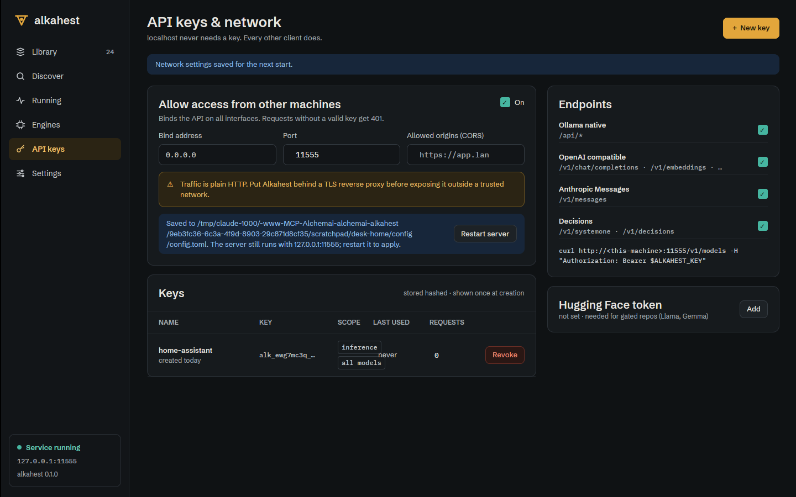
    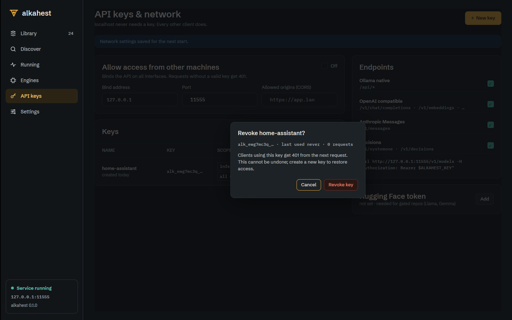
  - Engines: llama.cpp `vulkan` (30 MB) installed from its chip with live progress, then
    removed through dialog 17.13; the bundled CPU build untouched.
    
    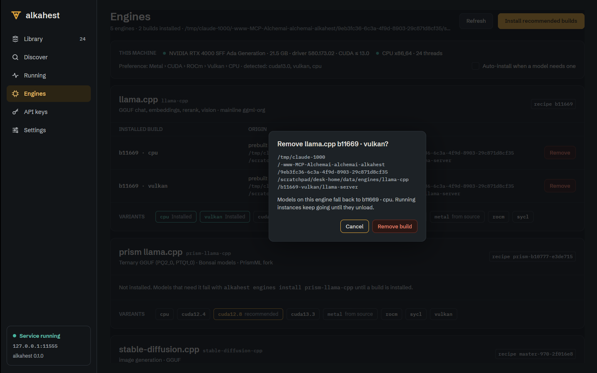
  - Settings: keep-alive 30m and max loaded 2, "2 unsaved changes", Save & restart server:
    `config.toml` got `[scheduler] keep_alive = "30m" max_loaded = 2`, the server restarted
    with them (new pid, `/alkahest/v1/info` scheduler), then reset through the API.
    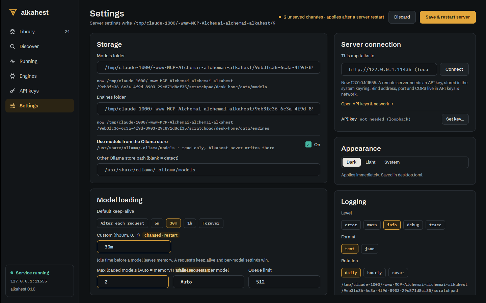
  - States: first run, server stopped, connection lost (remote URL), unauthorized
    (`require_on_loopback`), delete refused for an Ollama-store model, stop all with "Unload
    idle", Running empty.
    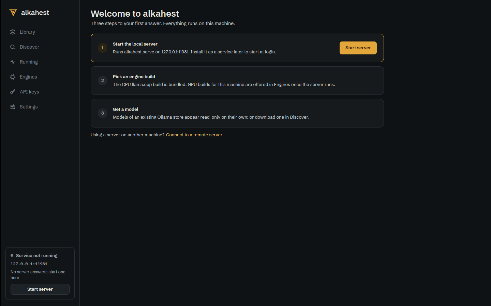
    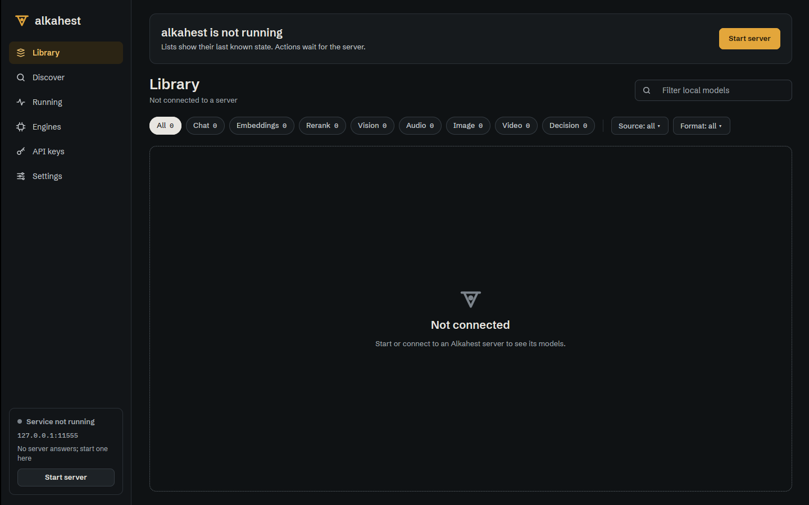
    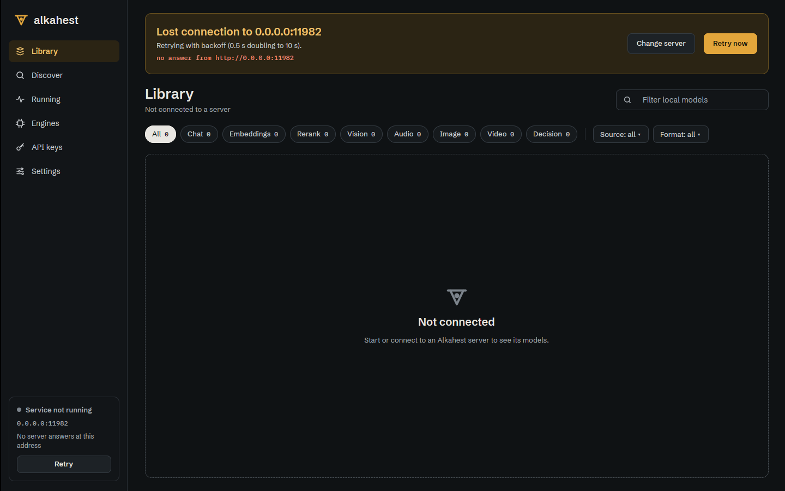
    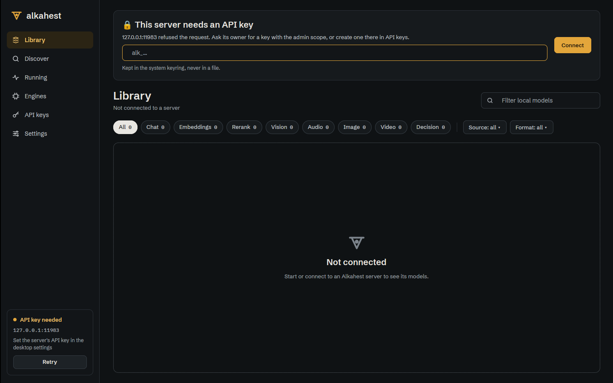
    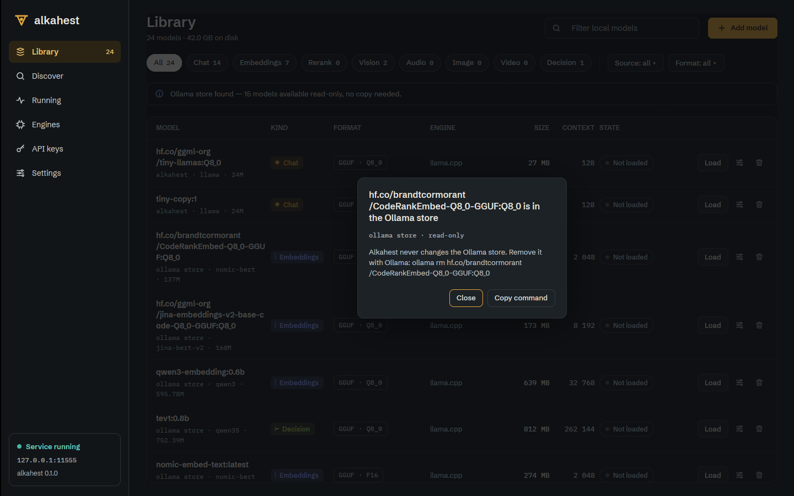
    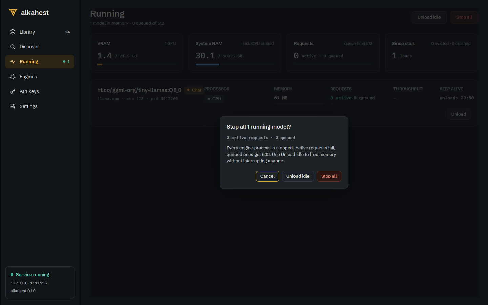

## Deviations and follow-ups

- Desktop screens 14-17 land in one commit: they share the shell, the dialog widget and the
  restart flow, so a per-story split would only produce intermediate states that do not
  build. The server route and the tray are separate commits.
- Keys table shows total authenticated requests, not a 24 h count (the usage tracker keeps
  totals); scope chips show scopes and the model allowlist (kinds/endpoint scopes do not
  exist server-side).
- Engines: no "Reload recipes" (no route; "Refresh" re-reads the listing), no "Override…"
  sheet (no route for `engines.overrides`), no build log tail (install jobs report phases and
  bytes only; the card shows the phase history), no download size on recommended chips, no
  "bundled" tag (the listing does not say which build shipped with the binary). Inbox item
  filed.
- Settings: "Choose…" folder pickers are not offered (the server may be remote; paths are
  typed); keep-alive needs a restart like every server setting (the design says it applies
  live). Removing every key of a table leaves an empty `[table]` header in `config.toml`.
- States: no retry countdown in 17.5 (the snapshot does not carry the backoff delay); 17.8
  "Install prebuilt instead" and the load-failure actions are not wired; 17.11 kill engine
  does not exist (no forced kill route). Dialogs close with their buttons; Esc and backdrop
  clicks do not close them yet.
