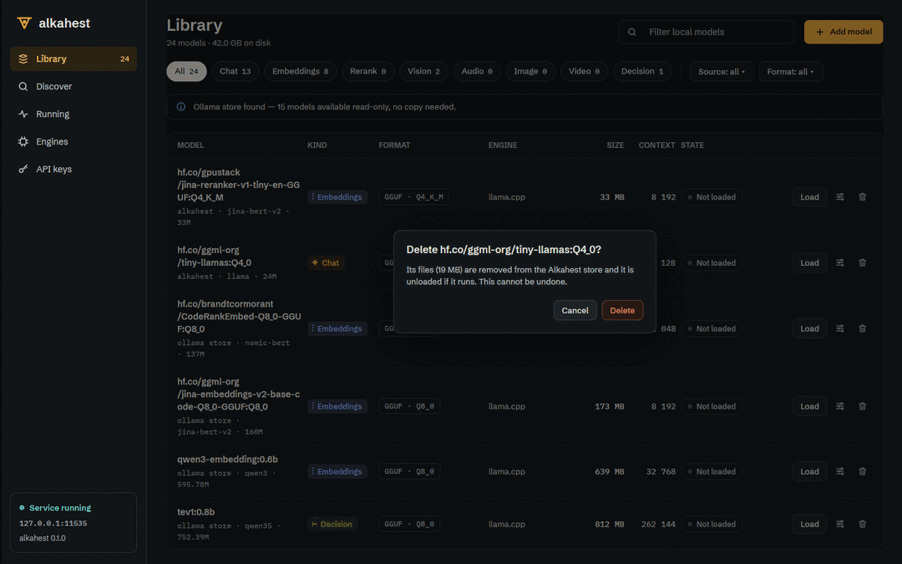

# Desktop Library view (ALK-US-0066)

Date: 2026-10-17. Story [[ALK-US-0066]], requirement [[ALK-SP-0008.R3]], plan
[[plan/alkahest-v1-plan]]. Tasks ALK-T-0180, ALK-T-0181. Builds on
[[2026-10-17-desktop-crate-scaffold]] and [[2026-10-17-desktop-server-connection]]; data from
[[2026-10-17-ollama-native-api]], [[2026-10-17-openai-api]] and
[[2026-10-17-scheduler-runtime-metrics]].

## What changed

- `alkahest-client` (additive):
  - `Client::library() -> Vec<LibraryModel>` (`src/library.rs`): `/api/tags` merged with
    `/v1/models` (`owned_by` = catalog source; listed = loadable) and `/api/show` per model,
    four at a time (trained context length). Extra sources are best effort: a failing
    `/v1/models` or `/api/show` leaves `source` / `loadable` / `context_length` at `None`.
    `LibraryModel` also deserializes the catalog's `ModelSummary` JSON (`kind`, `engine`), so
    the future admin catalog route drops in.
  - `Client::delete` (`DELETE /api/delete`), `Client::unload_all`
    (`POST /alkahest/v1/unload {"all": true}`).
  - `RuntimeModel` gained the rest of the scheduler's `ModelStatus` (`processor`
    `ProcessorSplit`, `gpu_layers` / `total_layers`, `keep_alive`, `expires_in_ms`,
    `active_requests`, `queued_requests`, token totals, `tokens_per_second`, `loaded_at`, ...);
    `SchedulerStatus.memory: Option<MemoryStatus>`. All lenient (`serde(default)`).
- `alkahest-desktop`, GPUI-free (default workspace, unit tested):
  - `present.rs`: `format_bytes` (`5.2 GB`), `group_digits` (`32 768`), `kind_of` (server kind
    id, else from capabilities), `kind_token` / `kind_label` (via `ModelKind::token_key()`, so
    completion is counted as Chat and both speech kinds as Audio), `FormatTag` (brass for
    `PQ2_0`/`PTQ1_0`, dashed for Ollama-store models), `default_engine` (ALK-SP-0003.R2 rule by
    format when the model is not loaded), `Pill` / `PillKind` from the `processorState.*`
    token templates, `same_model` (`name` = `name:latest`).
  - `library.rs`: `LibraryState` (models, fetch status, `LibraryFilter` = text + kind chip +
    `SourceFilter` + `FormatFilter`, actions in flight, delete confirmation, notice, settings
    route), `kind_chips` (counts under the other filters), `rows(runtime)` merging the live
    scheduler snapshot (pill, Load/Unload, engine and context of the running instance),
    `request_delete` (Ollama-store models refused with an `ollama rm` hint, no request sent),
    `confirm_delete`, `begin` / `finish`.
  - `ops.rs`: `ModelOps` trait (load, unload = `keep_alive: 0`, delete, unload all, library)
    implemented for `Client`; `run` maps failures to one-line messages (`OpFailure`; 403 on
    delete = read-only hint, 401/403 on unload all = admin scope needed).
  - `connection.rs`: `Snapshot.runtime: Option<RuntimeSnapshot>` (the full scheduler
    snapshot from the SSE `status` events, `Arc`-shared, with its arrival time). The status
    stream now carries `SchedulerStatus`; `ServerApi::runtime` added. The health timer is
    pinned, so a busy event stream no longer postpones the 10 s probe.
- GUI (`gui` feature): `views/library.rs` `LibraryView` (header with summary, gpui-kit filter
  input, brass "Add model" → Discover via `LibraryEvent::Navigate`; kind chips; Source and
  Format dropdowns as deferred anchored menus; Ollama banner; notice line; table with
  sideways scroll below 980 px; delete confirmation dialog; screen 12 placeholder;
  empty/loading/failed/disconnected/no-match states). `views/widgets.rs`: `kind_badge`,
  `format_tag`, `pill`, `button` (`Primary`/`Secondary`/`Danger`), `icon_button`,
  `column_label`, `overlay_shadow`, `confirm_dialog`. New icons (settings, trash, search,
  plus, info). Facade: `Anchor`, `anchored`, `deferred`, `EventEmitter`, `BoxShadow`,
  `point`, `relative`, `ScrollHandle`, `input::{Input, InputEvent, InputState}`,
  `KitColors` + `sync_kit_theme` (the kit input draws with the Alembic palette; called from
  `Theme::install`). `Shell` owns the Library entity, forwards snapshots to it and shows the
  Library's own count in the rail (updated right after a delete). `app.rs` hands the client to
  the shell.

## Why

ALK-SP-0008.R3: list local models from all sources with kind, format, size and state, and
load, unload and delete them. The admin catalog route (ALK-US-0040) does not exist yet, so the
list is composed from existing routes in `alkahest-client` (no `alkahest-api` change, which
another stream is editing).

## Verification

- Scenario test `library::tests::unload` (ALK-SP-0008.R3 "unload"): unload on a loaded row,
  busy while in flight, the next snapshot without the model shows "Not loaded" and Load.
  Plus filter, chip-count, live-merge, delete-refusal, confirmation, ops and present tests;
  client tests `tests/library.rs` (wiremock) and `library::tests`. GUI tests (`gui-test`):
  `views::library::tests::connecting_fetches_the_list_and_reports_a_failure`,
  `rows_render_and_delete_asks_first`.
- `WAYLAND_DISPLAY= scripts/ci-local.sh --desktop`: fmt, clippy (default and desktop
  features), nextest 790 passed, deny, check-deps, `tokens --check --contrast`, headless
  build, GUI tests 49 passed, desktop build, smoke test "first frame rendered in 1212 ms",
  typos: all passed. `cargo machete` clean for both crates.
- End to end under Xvfb (lavapipe) against `alkahest serve` on 127.0.0.1:11535 with a scratch
  `ALKAHEST_HOME`, the CPU llama.cpp engine and the machine's Ollama store read-only: list of
  23 models with badges, dashed tags on Ollama models, filters and dropdowns, delete refused
  for an Ollama model with the hint, delete of a pulled copy after confirmation (rail counter
  24 → 23), Load (pill "GPU 87% · CPU 13%", Running counter 1) and Unload (back to "Not
  loaded"), settings placeholder, no-match state.
  

## Deviations and follow-ups

- No load progress from the server: the loading pill reads "Loading…" without a percentage,
  and there is no "Cancel" for a load in flight.
- The store path in the subtitle, the Ollama store path in the banner and "Manage sources"
  need the admin catalog route: inbox item [[ALK-US-0097]] (for [[ALK-US-0040]]).
- Empty/error states are tokenised but not designed: [[ALK-US-0081]].
- Model settings (screen 12) open a placeholder until [[ALK-US-0069]].
