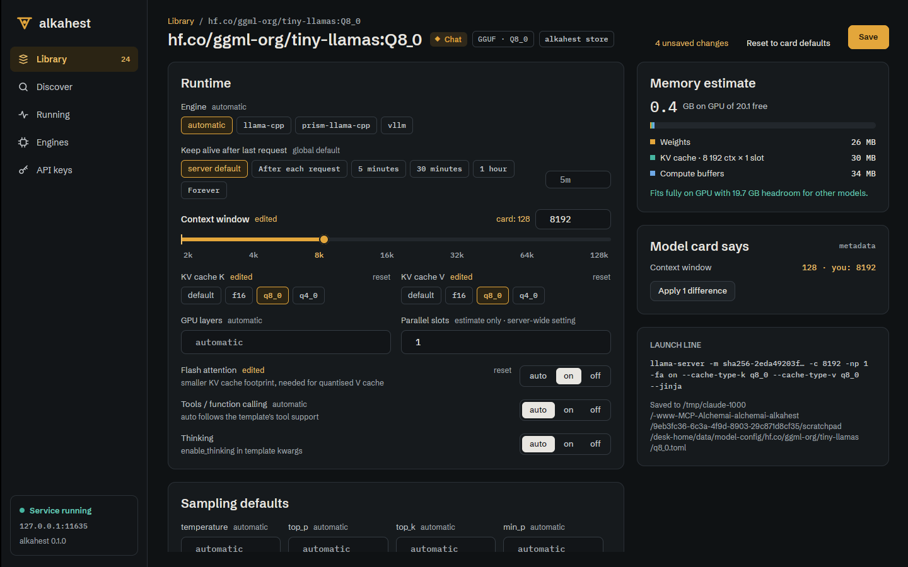

# Desktop model settings editor (ALK-US-0069)

Date: 2026-10-17. Story [[ALK-US-0069]], requirements [[ALK-SP-0008.R5]] and
[[ALK-SP-0010.R3]], plan [[plan/alkahest-v1-plan]]. Tasks ALK-T-0186, ALK-T-0187,
ALK-T-0188, ALK-T-0189. Builds on [[2026-10-17-model-config-overlay]],
[[2026-10-17-recommended-params]], [[2026-10-17-memory-estimator]],
[[2026-10-17-admin-api]] and [[2026-10-17-desktop-library-view]].

## What changed

- `alkahest-desktop/src/model_settings.rs` (GPUI-free, unit tested): `FIELDS` (engine,
  keep-alive, context, KV cache K/V, GPU layers, flash attention, tools, sampling set,
  max_tokens, seed, template, extra args) with `FieldKind` limits matching the server's
  validation; `parse_field` (`32k`, `all` GPU layers, Ollama durations via `parse_duration`,
  quoted engine arguments via `split_args`), `value_text`; `SettingsForm` over the
  `ModelSettingsDoc` (`display` -> effective value + `Origin` model / recommended / global /
  automatic / edited, `set_text` with per-field errors, `set_value`, `clear`, `set_thinking`,
  `dirty`, `changes`, `card_diffs` + `apply_card`, `to_save`, `estimate_query`,
  `launch_line`, `reload`); `recommended_settings` (flattened or nested sampling);
  `Debounce` (generation per edit, stale answers dropped); `EstimateView` (headline, stacked
  bar segments, legend, verdict: fits with headroom / partial offload n/m layers / does not
  fit / CPU); `context_position` (log scale 2k..128k).
- GUI `views/model_settings.rs` `ModelSettingsView` (opened from a Library row, replaces the
  placeholder): breadcrumb, kind badge, format tag, source tag (dashed "ollama store ·
  read-only blob"), unsaved count, "Reset to card defaults" (`DELETE .../settings`), brass
  "Save" / "Save & reload" while loaded (PUT, then unload + load). Runtime card (engine chips,
  keep-alive presets + custom field, context slider with log stops, the card value marked and
  a numeric field, KV cache chips, GPU layers, parallel slots for the estimate, flash
  attention / tools / thinking auto-on-off), sampling card, chat template card (model template
  from the detail route, GGUF jinja or Ollama TEMPLATE, or Custom in a kit text area), extra
  engine arguments; side column: live memory estimate (debounced 300 ms
  `GET .../estimate`), "Model card says" with "Apply n differences", launch line and the
  overlay path. Every field shows its origin and offers "reset" when the overlay sets it.
  `LibraryView` hosts the entity and feeds it the loaded state. Facade: `Textarea`,
  `TextareaState`; widget `field_label`.
- `alkahest-client`: `CatalogModel::parameters` reads a non-string as `None`, because the
  admin detail route reuses that key for the default parameter map and every
  `Client::model()` call failed to decode (inbox [[ALK-US-0103]] for the server side).

## Why

ALK-SP-0008.R5: edit per-model settings with the effective value and where it comes from,
with a memory estimate that follows the edits. ALK-SP-0010.R3: the recommended values stored
at pull time are shown as such and restorable. The overlay lives in Alkahest's data dir, so
read-only Ollama-store models are configured without touching the Ollama store.

## Verification

- Scenario tests `model_settings::tests::estimate` (ALK-SP-0008.R5 "estimate": doubling the
  context changes the estimate request, the old answer is stale, the new one shows the larger
  KV cache) and `model_settings::tests::sampling_defaults` (ALK-SP-0010.R3 "sampling
  defaults": Qwen3 temperature, top_p, top_k, min_p from the card, origin recommended). Plus
  edits/validation, card diffs, reload, launch line, durations, slider and estimate verdict
  tests; client `admin::tests::model_detail_with_a_parameter_map_decodes`; GUI test
  `views::model_settings::tests::the_form_renders_edits_and_drops_card_overrides`.
- `WAYLAND_DISPLAY= scripts/ci-local.sh --desktop`: all checks passed.
- End to end under Xvfb against `alkahest serve`: Ollama-store `qwen2.5-coder:0.5b`: 16k
  context, q8_0 K/V, flash attention on -> estimate KV 107 MB at 16 384 ctx, launch line
  `-c 16384 -np 1 -fa on --cache-type-k q8_0 --cache-type-v q8_0`; Save wrote
  `<data>/model-config/registry.ollama.ai/library/qwen2.5-coder/0.5b.toml`, origins turned to
  "model setting"; `find /usr/share/ollama/.ollama/models -newer <marker>` empty (store
  untouched). HF `tiny-llamas` Q8_0: recommended context 128 shown as "card: 128", 8k edit
  listed under "Model card says" with "Apply 1 difference".

## Deviations and follow-ups

- Parallel slots are not a per-model setting on the server; the field drives the estimate
  only. Inbox [[ALK-US-0102]].
- KV cache chips offer f16, q8_0, q4_0: the estimator knows only those (other llama.cpp types
  can go in extra arguments). See [[ALK-US-0104]].
- Batch size, threads and mmap of the design have no overlay field; extra engine arguments
  cover them (`-b`, `-t`, `--no-mmap`).
- The context slider uses clickable log stops plus a numeric field (no drag).
