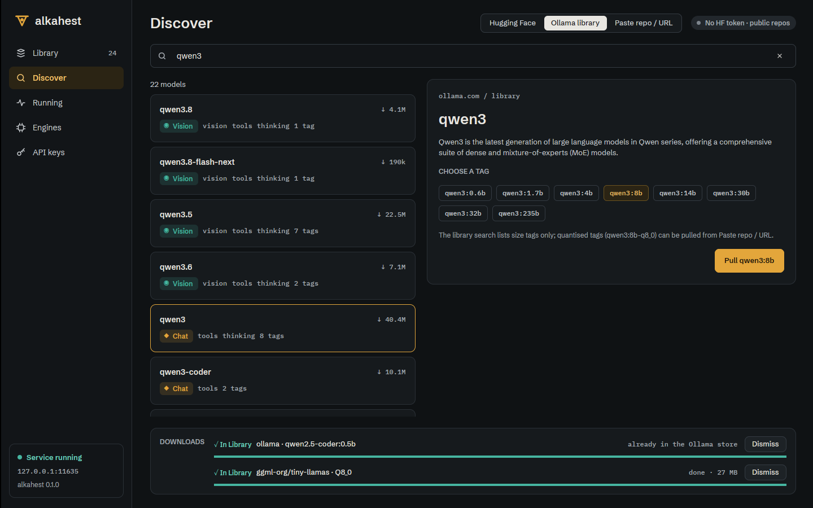

# Desktop Ollama library browser (ALK-US-0068)

Date: 2026-10-17. Story [[ALK-US-0068]], requirement [[ALK-SP-0008.R4]], plan
[[plan/alkahest-v1-plan]]. Task ALK-T-0185. Builds on [[2026-10-17-desktop-hf-browser]]
(Discover screen, downloads strip, pull jobs) and [[2026-10-17-admin-api]]
(`GET /alkahest/v1/ollama/search`).

## What changed

- `alkahest-desktop/src/discover.rs` (GPUI-free, landed with the shared Discover state of
  ALK-US-0067): `OllamaRow` / `ollama_row` (kind from the capabilities, capability chips, pull
  count, one pull tag per listed size, `name:latest` when none, cloud-only models not
  pullable), `DiscoverState::finish_ollama_search` (keeps the selection while listed, else the
  first result), `ollama_row`, `ollama_pull` (chosen tag, else the first).
- GUI `views/discover.rs`: the Ollama library tab: search field (debounced), results list
  (name, pulls, kind badge, capabilities, tag count), detail card (description, tag chips with
  the brass selection, the tag limitation note, brass "Pull qwen3:8b"). Pulls are pull jobs
  shown in the same downloads strip; a model already in the Ollama store completes at once as
  "already in the Ollama store" (read-only reuse, nothing copied). Paste tab accepts Ollama
  tags, `ollama.com/library/...` URLs and `user/model:tag`. Widget `choice_chip`.

## Why

ALK-SP-0008.R4 covers both catalogues: the Ollama library is searched and pulled the same way
as Hugging Face, through the server.

## Verification

- `discover::tests::ollama_rows_list_tags_and_pull_the_chosen_one`,
  `pasted_text_is_parsed`; GUI and workspace suites as in the story comment
  (`WAYLAND_DISPLAY= scripts/ci-local.sh --desktop` passed).
- End to end under Xvfb against `alkahest serve`: search "qwen3" (22 models), qwen3 with eight
  size tags, chip selection changes the pull button; `qwen2.5-coder:0.5b` pulled from the
  Paste tab completed immediately as reused from the read-only Ollama store and appeared in
  the Library.

## Limitations and follow-ups

- The library search lists size tags only (`qwen3:8b`), without byte sizes or quantised tags
  (`qwen3:8b-q8_0`); those can be pulled from Paste. A tags listing route is
  [[ALK-US-0099]].
