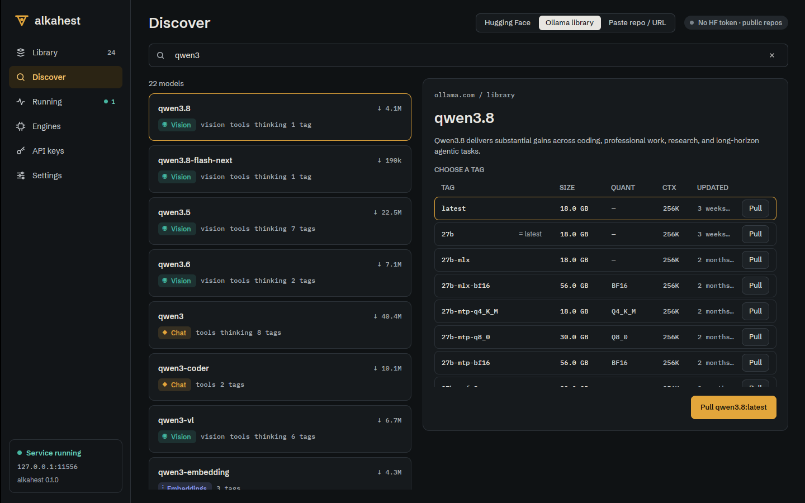
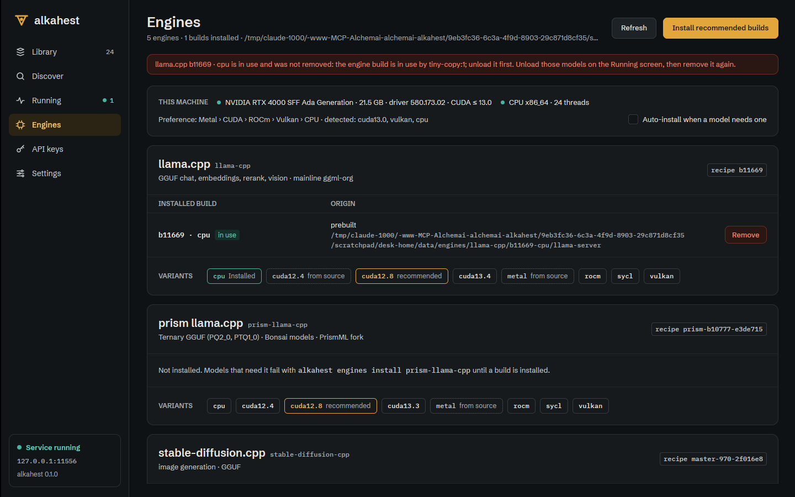

# Desktop: Ollama tags, load progress, engine in use (ALK-US-0099)

Date: 2026-10-17. Desktop part of [[ALK-US-0099]] ([[ALK-SP-0008]].R4, [[ALK-SP-0005]].R6).
Server part: [[2026-10-17-admin-engine-in-use-load-progress-library-tags]]. Builds on
[[2026-10-17-desktop-ollama-browser]] and [[2026-10-17-desktop-keys-engines-settings]].
Plan: [[plan/alkahest-v1-plan]].

## What changed

- `alkahest-desktop/src/discover.rs`: `TagRow` / `tag_rows` (size from `size_bytes`, quantisation,
  context, age, vision badge, `alias_of` for tags sharing a digest), `DiscoverState::{ollama_tags,
  ollama_tags_for, ollama_tags_wanted, begin_ollama_tags, finish_ollama_tags}` (request generation,
  fetched once per selection, never for cloud-only models); `ollama_pull` now accepts any listed tag and
  defaults to `latest` (else the first tag) once the list arrived.
- `alkahest-desktop/src/views/discover.rs`: `load_ollama_tags` (on selection and after each search),
  `tag_table` (scrolling list, a click chooses the tag, the row button pulls it at once, the brass button
  pulls the chosen one); while loading or when the page cannot be read the size chips of the search are
  shown with a one-line explanation.
- `alkahest-desktop/src/present.rs`: `Pill::loading_at(progress)`; `Pill::for_runtime` shows
  `Loading 42 %` from `RuntimeModel::load_progress`, so the Library state pill and the Running card show it
  (the Running card bar is [[2026-10-17-desktop-running-live-monitor]]).
- `alkahest-desktop/src/engines.rs` `remove_failure` and `views/engines.rs`: the 409 of an engine removal in
  use becomes "<engine> <build> was not removed: <server message naming the models>. Stop those models from
  the Running screen first."

Not done here: the "Restart server" action of point 4 of the story (desktop settings already restart the
server, see [[2026-10-17-desktop-tray-autostart]]).

## Verification

- Unit: `discover::tests::library_tags_become_rows_and_the_default_pull_prefers_latest`,
  `present` loading pill test, `engines::tests::removing_a_build_in_use_is_explained`.
- Xvfb against `alkahest serve` (scratch home, ollama.com reachable): searching `qwen3` lists the tags of the
  selected model with sizes and a Pull per tag; removing the CPU llama.cpp build while `tiny-copy:1` was
  loaded showed the refusal, the build stayed installed and was tagged `in use`.
