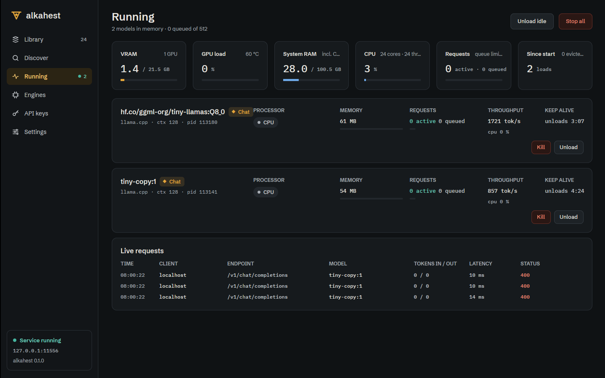
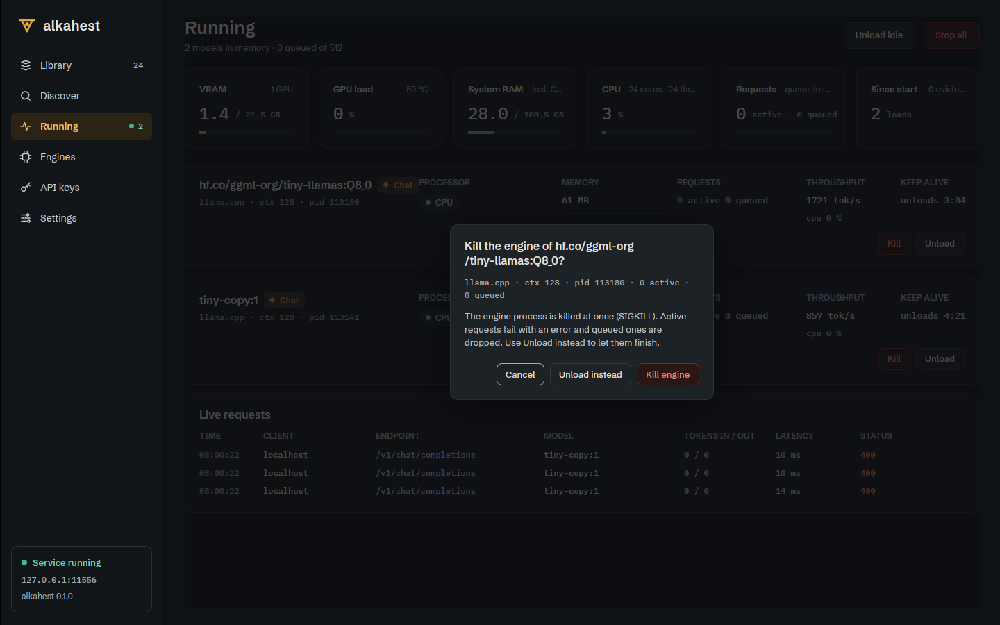
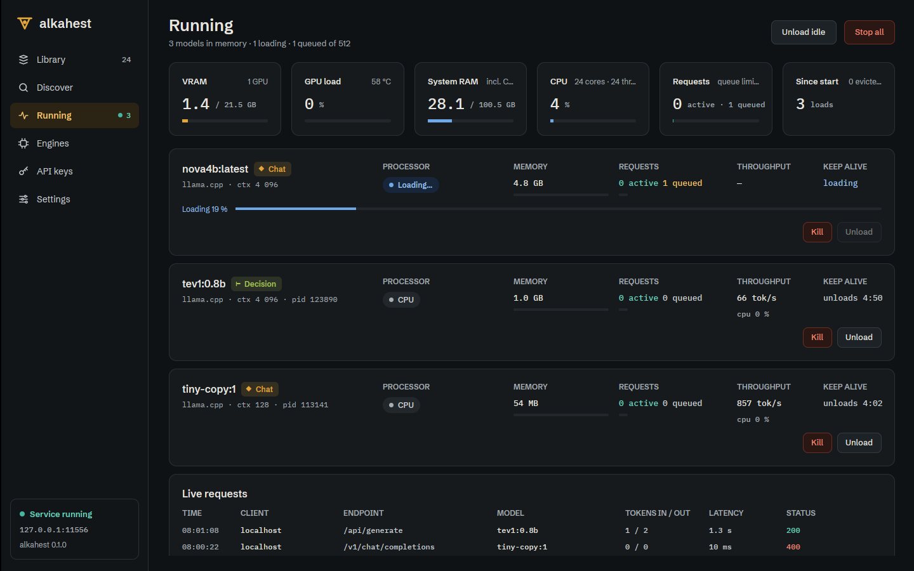

# Desktop Running: utilisation tiles, live requests, kill (ALK-US-0098)

Date: 2026-10-17. Desktop part of [[ALK-US-0098]] ([[ALK-SP-0008]].R6, [[ALK-SP-0004]].R7). Uses the
server data of [[2026-10-17-runtime-monitor-data]] and
[[2026-10-17-admin-engine-in-use-load-progress-library-tags]]; extends
[[2026-10-17-desktop-runtime-monitor]]. Plan: [[plan/alkahest-v1-plan]].

## What changed

- `alkahest-desktop/src/running.rs`: `tiles` adds `GPU load` (percent, temperature as detail, one tile
  per GPU when there are several) and `CPU` (percent, cores and threads) from
  `SchedulerStatus::utilization`; `ModelCard::{cpu, load_progress}` (engine CPU `cpu 38 %` under
  throughput, progress while loading); `RequestLog` / `RequestRow` / `request_row` (newest first, 40
  rows, duplicates by id ignored, `/api/show` metadata lookups skipped, tokens in / out, duration, slow
  (>= 30 s) and non-2xx in cinnabar, aborted); `RunningState::{ask_kill, confirming_kill, cancel_kill,
  confirm_kill, finish_kill, is_killing}`.
- `alkahest-desktop/src/ops.rs`: `ModelOp::Kill`, `ModelOps::kill` (`Client::kill_model`), 401/403 message.
- `alkahest-desktop/src/connection.rs`: `on_runtime` keeps the last `utilization` and per-model
  `cpu_percent` when a status event (which carries neither) replaces the `ps` poll snapshot.
- `alkahest-desktop/src/views/running.rs`: six tiles on one row (details truncate), card Kill (cinnabar)
  and load progress bar (signal blue, "Loading 19 %"), `requests_table` ("Live requests": time, client,
  endpoint, model, tokens, latency, status) fed by `follow_requests` (initial `recent_requests`, then SSE
  `request` events, reconnect after 3 s, dropped when disconnected), Kill confirmation dialog 17.11
  (Cancel focused, "Unload instead", "Kill engine" cinnabar; Esc and backdrop cancel).

## Why

[[ALK-SP-0008]].R6 and design screen 13 ask for GPU load, CPU, a live requests table and a kill action
next to Unload.

## Verification

- Unit: `running::tests::{utilization_adds_gpu_and_cpu_tiles, cards_show_cpu_and_load_progress,
  request_log_dedupes_and_formats_rows, kill_asks_first_and_runs_once}`,
  `connection::tests::status_events_keep_the_last_utilization`, `ops::tests::ops_reach_the_server` (kill).
- GUI test `views::running::tests::live_snapshot_renders_cards_and_stop_all_asks_first` also opens the
  kill dialog.
- Under Xvfb against `alkahest serve` (scratch home, CPU llama.cpp, tiny models): tiles with real NVML
  load and temperature, feed rows from `/api/generate` and `/v1/chat/completions` (a 400 shown in
  cinnabar), Kill confirmed through the dialog removed the card (engine SIGKILL), a 4.4 GB model showed
  "Loading 19 %" with the bar.
- `WAYLAND_DISPLAY= scripts/ci-local.sh --desktop`: run at the end of the batch (see the Engines record).
