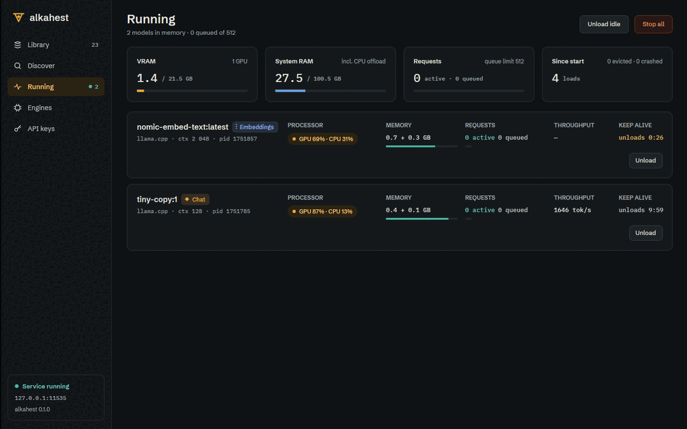

# Desktop runtime monitor (ALK-US-0070)

Date: 2026-10-17. Story [[ALK-US-0070]], requirement [[ALK-SP-0008.R6]], plan
[[plan/alkahest-v1-plan]]. Tasks ALK-T-0190, ALK-T-0191. Builds on
[[2026-10-17-desktop-library-view]], [[2026-10-17-desktop-server-connection]] and
[[2026-10-17-scheduler-runtime-metrics]].

## What changed

- `alkahest-desktop/src/connection.rs` (status stream subscription, ALK-T-0190): while
  connected the manager keeps the full scheduler snapshot (`Snapshot.runtime`) from the SSE
  `status` events and polls `/alkahest/v1/ps` every `RUNTIME_POLL` (2 s; that route also
  re-measures memory, which the events do not). A 401/403 on the poll (key without the admin
  scope) stops polling; events keep working when allowed.
- `alkahest-desktop/src/running.rs` (GPUI-free, unit tested): `ModelCard` per loaded model
  (`engine_line` = engine · ctx · -np · pid · GPU layer split, processor `Pill`, memory
  `VRAM + RAM GB`, `vram_share`, active/queued, one slot segment per parallel slot,
  throughput, `KeepAlive` = busy / loading / draining / never / countdown / idle, counted
  down locally from the snapshot's arrival, brass under 60 s), `cards` (kind from the
  Library), `tiles` (VRAM per detected GPUs, system RAM, requests vs queue limit, loads /
  evictions / crashes), `summary`, `RunningState` (unloads in flight, "Unload idle"
  targets, Stop-all confirmation, notice).
- GUI `views/running.rs` `RunningView` (ALK-T-0191): header with Unload idle (secondary) and
  Stop all (cinnabar, confirmation dialog, `POST /alkahest/v1/unload {"all": true}`), tiles
  with meters (brass VRAM, signal-blue RAM, verdigris queue), model cards with the
  processor pill, memory bar, slot segments (verdigris = busy), throughput, keep-alive
  countdown and Unload (`keep_alive: 0`); a 1 s ticker re-renders only while a countdown is
  shown; empty / waiting / disconnected states with a link to the Library. `meter` widget.
  `Shell` owns the entity and forwards snapshots; the rail counters were already live (Running
  from the snapshot, Library from the Library view).

## Why

ALK-SP-0008.R6: loaded models with CPU/GPU placement, RAM and VRAM, in-flight and queued
requests, refreshed at least every 2 seconds. Events alone only fire on scheduler changes;
the poll guarantees the refresh rate and fresh memory figures.

## Verification

- Scenario test `running::tests::activity` (ALK-SP-0008.R6 "activity": the in-flight count
  is 1 while a completion streams, 0 after). `connection::tests::
  runtime_is_polled_every_two_seconds_while_connected` (paused clock: three snapshots within
  4 s with a silent event stream). Card, countdown, tiles, kinds, unload-idle and stop-all
  tests; GUI test `views::running::tests::live_snapshot_renders_cards_and_stop_all_asks_first`.
- `WAYLAND_DISPLAY= scripts/ci-local.sh --desktop`: all passed (nextest 797, GUI tests 57,
  smoke test "first frame rendered in 660 ms"); `cargo machete` clean;
  `cargo xtask tokens --check --contrast`, smoke test under `xvfb-run`.
- End to end under Xvfb against `alkahest serve` with the CPU llama.cpp engine: two models
  loaded through the API, countdown ticking and turning brass, the 75 s model unloaded on its
  own and disappeared (Running counter 2 → 1), reload with a larger context shown (new pid,
  ctx 32 768), throughput after a generation, Stop all with confirmation → empty state.

## Deviations and follow-ups

- GPU load and CPU utilisation tiles of the design have no data source (the snapshot has
  memory only), and the live requests table needs a request feed; inbox [[ALK-US-0098]].
- No "kill" button: the API has no forced kill distinct from unload, so each card offers
  Unload only.
- An in-flight request was not caught on screen with the tiny test model (generations finish
  in well under a second); the scenario is covered by the unit test.
