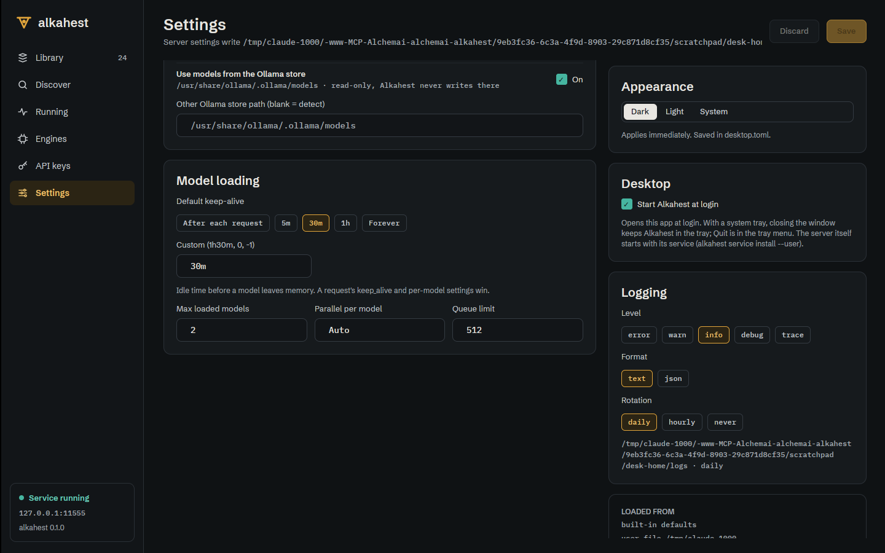

# Desktop tray icon and start at login (ALK-US-0073)

Date: 2026-10-17. Story [[ALK-US-0073]], task ALK-T-0195. Builds on
[[2026-10-17-desktop-keys-engines-settings]] (restart/stop of the local server, Settings) and
the Pando Assistant tray (`crates/app/src/shell/tray.rs`). Plan: [[plan/alkahest-v1-plan]].

## What changed

- `alkahest-desktop/src/tray.rs`: `TrayModel` (running, busy, loaded, manages_server),
  `TrayAction` (Open, StopAllModels, StartServer, StopServer, Quit), `menu` (Open Alkahest ·
  status line · Stop all models · Start/Stop server (local server only) · Quit), `tooltip`,
  `icon_rgba` (rasterises `design/brand/mark-tray.svg` with resvg: bone on Linux and Windows,
  template black on macOS). Backends: Linux `ksni` on its own thread (retries while the
  StatusNotifierWatcher appears, marks the handle active only once registered); macOS and
  Windows `tray-icon` on the GPUI thread (`apply_pending` rebuilds the menu). `TrayHandle`
  (`update`, `is_active`).
- `app.rs`: `AppState` global (launch options, window, tray); the window can be reopened from
  the tray (`open_window` builds a new connection and shell); closing the window quits only
  when no tray is active; `ALKAHEST_DESKTOP_TRAY=0` (or `false`/`off`) disables the tray; the
  smoke test never starts it. Clicks run on the GPUI thread (`on_tray_action`).
- `views/shell.rs`: pushes a `TrayModel` with every snapshot; `Shell::tray_action` (start, stop
  with the pid from `/alkahest/v1/info`, unload all).
- `autostart.rs`: start at login: XDG autostart entry (Linux), LaunchAgent plist (macOS), `Run`
  registry value through `reg.exe` (Windows); `is_enabled`, `set_enabled`. Settings shows a
  "Desktop" card with the toggle (screen 16 has no such control; placed with the app settings).
- Dependencies: `ksni =0.3.6` (Unlicense, `async-io` feature; zbus already locked by gpui),
  `tray-icon =0.21.3` (MIT OR Apache-2.0, macOS/Windows only), `resvg` (already pinned) in
  `alkahest-desktop`, all behind the `gui` feature. `deny.toml`: `Unlicense` allowed;
  RUSTSEC-2024-0370 (proc-macro-error) ignored because it is reachable only through
  tray-icon's Linux GTK backend, which is never compiled.

## Why

ALK-US-0073: tray icon with server status and quick actions (open window, unload all, quit),
ksni on Linux and tray-icon on macOS/Windows, plus autostart. The tray menu and notifications
are not in the design canvas (`design/README.md`, "Not designed yet"), so the menu is a
minimal native one and the icon is the brand tray mark.

## Verification

- Tests: `tray::tests::menu_offers_open_status_stop_all_server_and_quit`,
  `#tooltip_names_the_state`, `#the_mark_rasterises_with_a_transparent_background` (gui),
  `autostart::tests::entry_is_written_and_removed_under_xdg_config_home`,
  `#plist_starts_the_desktop_at_load`, `app::tests::the_tray_is_on_unless_turned_off`.
- `cargo deny check`: advisories, bans, licences, sources ok. Headless build links no tray
  crate (`cargo tree -p alkahest --no-default-features`).
- Under Xvfb: the Settings toggle wrote and removed
  `$XDG_CONFIG_HOME/autostart/es.digio.alkahest.desktop` (scratch config dir, `Exec="…/alkahest"
  desktop`).

## Deviations and follow-ups

- The tray itself was not exercised on a live panel in this session (the screenshots run in
  Xvfb with `ALKAHEST_DESKTOP_TRAY=0` so no icon appears on the developer's desktop); the
  macOS/Windows backend compiles only on those targets and was not built here. Product owner
  check on a real desktop wanted.
- No notifications yet (download finished, load failed): not designed.
- The autostart entry opens the window; there is no "start hidden in the tray" flag.
